# FPA CET 1 Research Handoff

**Evidence-based research audit for a first-year doctoral evaluation, University of Luxembourg.**

Audit date: 19 October 2026, Europe/Luxembourg. Language: English. Scope: Forking Paths Analysis (FPA) only. This document is self-contained; the recipient does not need the preceding conversations.

**Instructions to the receiving presentation agent:** Present the methodological adaptation and completed experiments first. Introduce applications, including adversarial attacks, afterwards. Do not present a backdoor/attack experiment as completed. Do not convert a representative example into an aggregate conclusion, a weak correlation into independence, or a sensitivity measurement into a validated uncertainty estimator.

Only the synthesis report and transfer ZIP are created by this audit. Existing research code, configurations, datasets, results, and figures are not modified. No inference or new figures are generated. Some descriptive coefficients are newly recomputed from existing CSVs; these are explicitly labelled below.

## 1. Executive scientific summary

### 1.1 Research question and defensible contribution

The project investigates **how alternative local choices in a forecasting model change its subsequent predictions**. It adapts FPA from autoregressive text generation to numerical forecasts, implementing architecture-specific interventions and measuring their propagation over a forecast horizon.

The defensible contribution at CET 1 is an implemented experimental methodology and a set of architectural and measurement findings: patch/quantile reinjection for TimesFM; value-token intervention followed by sampled continuations for Chronos; distributional shift curves; a family of temporal sensitivity scores; systematic scans and targeted refinement; uncertainty and scenario analyses. This is research progress, not yet an externally validated universal reliability metric or a demonstrated new attack. Evidence: `code/timesfm_fpa_legacy/`, `code/chronos_fpa/`, the archived TimesFM results and Chronos runs catalogued in Sections 2 and 4.

The main scientific lessons are:

1. The intervention must match the forecasting architecture. TimesFM quantile/patch choices and Chronos categorical value-token choices are different experimental objects, with different meanings of probability and continuation. See Section 3 and the TimesFM archived grid.
2. Sensitivity can be persistent and sometimes substantial, but the magnitude of the initially imposed change must be separated from subsequent propagation. A rare Chronos alternative on `currency_5` directly imposes an approximately 50% level reduction; its large score is not evidence of amplification of a small shock. See clean-run audit below.
3. Scale handling materially changes comparisons. Raw scores mix numerical units and dimensionless features. The current primary score normalizes dimensional components by context IQR, using the same definition for all datasets. Changing normalization can still change rankings and correlations. Sources: `docs/CHRONOS_METRICS.md`, `docs/CHRONOS_MATH_AUDIT.md`, `C/recherche/audit_20260922/normalization_sensitivity.csv`.
4. Local model uncertainty and downstream FPA sensitivity have heterogeneous relationships. In the clean run, uncertainty-index/FPA Spearman correlations are +0.124 for ERCOT, -0.332 for Exchange Rate, and +0.302 for M4 Daily. A pooled coefficient is insufficient. Source: `C/recherche/model_uncertainty_alignment/model_uncertainty_fpa_correlations.csv`.
5. FPA is **not established as a forecast-error predictor**. Correctly aggregated clean-run window-maximum FPA versus normalized baseline MAE has Spearman +0.186 over 63 windows, with inconsistent dataset results. These accuracy coefficients are recomputed in this audit, not an existing formal validation study. Details and the relevant visualization issue are in Section 5.
6. High-FPA branches change certain generic forecast rules more often, but the rules are still exploratory. Example: final-direction changes on Exchange Rate occur in 58% of its highest-score quartile versus 32% of the remaining alternatives. This is an association between measurements of the same forecasts, not a validated decision benefit. Source: `C/recherche/audit_20260922/scenario_fpa_relationship.csv`.
7. Negative and inconclusive work is informative: short-series window constraints, scale domination, a partially corrupted refinement, plateaus that invalidate naive peak timing, and missing independent sampling controls delimit the current conclusions. Sources are given throughout Sections 4-6.

### 1.2 Evidence hierarchy and path conventions

Workspace root:

```text
C:/Users/alexandre.blain/OneDrive - University of Luxembourg/Desktop/timesfm_fpa
```

All paths below are relative to that root unless stated otherwise. An alias followed by `/file` means the exact root in this table concatenated with that filename. `ZIP!member` identifies a file inside an existing ZIP, not a loose file.

| Alias | Exact path | Role |
|---|---|---|
| T | `fpa_timesfm.zip!result/grid_spec_20260429_144333` | Preserved TimesFM grid, including numerical results and three figures |
| A1 | `result/archive/obsolete_chronos_runs/chronos_benchmark_scan_20260721_145719` | First retained local Chronos scan |
| A2 | `result/archive/obsolete_chronos_runs/chronos_benchmark_scan_20260721_151625` | Dominick single-token scan |
| A3 | `result/archive/obsolete_chronos_runs/chronos_benchmark_scan_20260722_105802` | Initial multi-dataset raw-score scan |
| A4 | `result/archive/obsolete_chronos_runs/chronos_benchmark_scan_20260724_100706` | Bundle experiment |
| N | `result/chronos_benchmark_scan_20260724_150121` | First retained component-normalized multi-dataset scan |
| P | `result/topology_temporal_single_20260724_175602` | Topology/temporal scan and refinement-selection source |
| I | `result/global_scan_less_dominick_with_refinement_20260727_165712` | Incomplete broad scan |
| J | `result/faster_global_scan_no_refinement_20260727_173315` | Complete July scan, historical window-scale normalization |
| R | `result/refinement_faster_global_20260728_125930` | Interrupted, mixed-schema targeted refinement |
| C | `result/clean_confirm_no_refinement_20260915_114823` | Complete September confirmation, context-IQR normalization |
| CA | `result/clean_confirm_no_refinement_20260915_114823/recherche/audit_20260922` | Existing detailed offline audit and diagnostics |

Evidence labels used in this report:

- **Observed:** directly present in retained configurations, CSVs, images, or checkpoint records.
- **Recomputed:** a cheap, read-only descriptive calculation performed for this handoff on existing data; no new model outputs.
- **Interpretation:** a scientific reading of observations, subject to stated limitations.
- **Hypothesis/future:** not yet established or implemented as an evaluated experiment.
- **Unavailable:** described historically or in code, but no corresponding retained result located.

Primary local sources are configurations and numerical outputs, then implementation, then research notes, then older presentations. When these conflict, this report identifies the conflict rather than treating prose as a current result. In particular, `docs/recherche/03_RESULTATS_RECENTS.md`, `04_AXES_FUTURS.md`, and `07_INCERTITUDE_MODELE_VS_FPA.md` retain July-era conclusions that must not be presented as the final September findings.

## 2. Chronological research progression

Dates are supported by dated run names, saved configurations/checkpoints, or archive members. File modification times alone are not treated as proof of scientific chronology. Dates of undocumented preliminary work remain unknown.

| Approximate stage/date | Initial scientific objective | Implemented work and retained evidence | Outcome / reason to proceed |
|---|---|---|---|
| Undated conceptual preparation; before the retained TimesFM grid | Transfer FPA's local-choice/alternative-continuation idea from language to forecasting | Architecture-specific branching code in `code/timesfm_fpa_legacy/`; original text-generation FPA is verified in Section 9 | Exact start date, first paper-reading date, and earlier unretained trials cannot be reconstructed |
| 29 April 2026 | Test whether quantile reinjection and patch changes affect autoregressive numerical forecasts | `T/config.json`, `T/experiments.csv`, `T/metrics.csv`, `T/block_analysis.csv`, `T/global_metrics.csv`; source in `fpa_timesfm.zip!fpa_timesfm/` | A preserved TimesFM 2.5 grid studies context and rollout interventions on a single natural-gas forecast window; quantile branching exists in code but must be distinguished from executed grid entries |
| Undated transition to Chronos; before 21 July | Obtain a direct categorical branching mechanism closer to the original FPA setting | `scripts/legacy_timesfm/run_fpa_chronos_token_bins.py`; supports DHHNGSP and level/log/log-return transforms | Early standalone implementation retained; historical `chronos_token_bins_20260630_105352` outputs mentioned previously are not present in the audited workspace and cannot substantiate June results |
| 21 July | Make dataset loading and short-series scans operational | A1 and A2 configs/summary/steps; local export downloader; adaptive context | First retained scan: one Dominick window; then three windows. Short series explain why `w0` can be the only available window |
| 22 July | Extend branching across datasets and track baseline error | A3, 15 windows, 15 samples; base-quality warnings | Raw scores dominated by ERCOT's numerical scale; baseline-quality diagnostics introduced |
| Morning 24 July | Explore short consecutive-token interventions | A4, bundle steps 0 and 12, 10 samples | Bundles run successfully but are computationally more expensive; they are not a controlled proof of superiority over single-token branches |
| Afternoon 24 July | Correct cross-dataset comparisons and study local topology and temporal shift | N then P; 20 then 68 windows; P steps 0,8,16,32 | Quantile-law shift, component-normalized scores, probability/entropy/margin comparisons and temporal variants support more interpretable diagnosis |
| 24-27 July | Add research infrastructure and select sensitive regions efficiently | Smoke folders under `result/archive/obsolete_chronos_runs/`; config readers, checkpoint/resume, auto-refinement | Infrastructure tests are not scientific replications; some use k=1 and therefore contain no alternative branch |
| 27-28 July | Reduce scan cost while retaining broad coverage | I stops after two groups; J completes 63 windows, steps 0,4,8,16, 10 samples | J provides a complete multi-dataset reference for historical uncertainty/scenario analyses; checkpoint completed 28 July 12:08:20 |
| 28-31 July | Refine selected windows with denser steps and more candidate tokens | R: k=15, 40 samples, steps 0,2,4,6,8,10,12,16; selected-window plan and checkpoint | 98 legacy-schema groups are readable; 45 later summary rows have another schema. Refinement is incomplete and does not constitute a clean stability validation |
| Exact implementation dates not fully recorded; analyses retained by September | Compare logits uncertainty with FPA, and test generic scenarios | `docs/recherche/07_INCERTITUDE_MODELE_VS_FPA.md`, `08_SCENARIOS_DECISIONNELS.md`; dedicated CSV/figure folders under J and R | Weak pooled historical correlations motivate non-redundancy questions; these are not forecast-accuracy correlations |
| 15-18 September | Confirm on the current context-IQR pipeline | C/config and checkpoint: 63 windows, 20 samples, 252 completed groups | Completed 18 September 11:36:33. Same window keys as J; differences include sample count and score definition, so not a one-factor normalization ablation |
| 21-22 September, according to retained analysis artifacts | Audit confirmation results and investigate artifacts | C uncertainty/scenario outputs; CA/ANALYSE.md, quality-versus-naive, normalization sensitivity, timing ties | Identifies rare large imposed jumps, normalization-dependent interpretation, sampled-base/greedy distinction, and plateau artifacts |
| Current proposed next stage | Test whether FPA-guided selection helps adversarial studies | Present user research brief; no completed local attack experiment located | BackTime integration is a future controlled comparison, after mapping forecast-output sensitivity to input/training-window selection |

## 3. Implemented FPA workflow

### 3.1 Independent methodological framing

Let a forecasting model take historical context x and produce a future sequence. Select a generation position b, keep the preceding forecast prefix fixed, intervene on a local choice, and let the model continue. The object of interest is the difference between the resulting conditional continuations.

This is a **model-behaviour intervention**, not automatically a causal explanation of the real-world data-generating process. The history is held fixed in Chronos token branching; TimesFM additionally supports deliberately changing observed context patches. Neither operation by itself establishes an adversarial attack.

Relative to the original text-generation method, this adaptation replaces semantic outcomes with numerical quantile differences, explores fixed top-k candidates even when very improbable, and reports branch-wise rather than probability-weighted aggregate effects. It does not reproduce the original change-point or survival analyses. These distinctions prevent presenting the implementation as a complete replication. Reference B1 supplies the original method; local source supplies the adaptation.

One-slide workflow, faithfully reflecting the Chronos implementation:

```mermaid
flowchart LR
    A["Local univariate series"] --> B["Sliding window: context + held-out future"]
    B --> C["Tokenize context; generate greedy reference prefix"]
    C --> D["Choose forecast step b; inspect top-k value tokens"]
    D --> E["Force base token and each alternative separately"]
    E --> F["Sample S continuations per forced choice"]
    F --> G["Compute horizon-wise q10,...,q90"]
    G --> H["Quantile-shift curve; temporal features; normalized FPA scores"]
    H --> I["Compare datasets, logits uncertainty, baseline error, scenarios"]
```



GT is used for evaluation and some legacy scale diagnostics, not supplied as forecast input. Source anchors: `code/chronos_fpa/chronos_benchmark_scan.py::{iter_sliding_windows,scan_window}`, `chronos_decoding.py::{decode_with_token_bin_intervention,_quantiles_from_samples}`, `chronos_analysis.py::{analyze_chronos_token_branches,summarize_chronos_branches}`.

### 3.2 Datasets, preprocessing, and observation units

**Chronos benchmark exports.** Source repositories are `autogluon/chronos_datasets` and `autogluon/chronos_datasets_extra`. The actual retained local manifest records four nonempty datasets from the former: Dominick 100 series, ERCOT 8, Exchange Rate 8, M4 Daily 100. `electricity_15min` has zero exported series and a zero-byte file. The presence of these datasets does **not** mean that the complete 42-dataset Chronos paper benchmark was downloaded or evaluated. Evidence: `data/raw/chronos_benchmark/manifest.json` and corresponding `autogluon_chronos_datasets__*__train.jsonl` files.

Targets are one-dimensional arrays. ERCOT identifiers include COAST, EAST, FAR_WEST, NORTH, NORTH_C; Exchange Rate identifiers are currency_1 through currency_8; M4/Dominick identifiers are T000000 etc. The exports have empty metadata in inspected records: do not invent actual currency names, business targets for individual M4 IDs, timestamps, or physical units from identifiers alone. No external log/log-return transform is applied in the benchmark-folder scanner. `_clean_target` converts to float32 and preserves nonfinite entries as NaN. Source: `chronos_benchmark_scan.py::{_clean_target,iter_benchmark_folder_series}`.

Selection is deterministic: sorted local files, matching dataset names, first admissible series within limits, then earliest windows. For context L and horizon H, default stride is floor(H/2), at least one. A window at start s contains `x[s:s+L]` and GT `x[s+L:s+L+H]`. Adaptive context applies only if a series is shorter than L+H: effective L becomes series_length-H, subject to min_context_len. In C, H=64, stride=32, L=512 except M4 series T000002/T000003/T000004, whose contexts are 80/119/106; each yields just w0. Source: C/config.json, C/chronos_scan_summary.csv, data JSONLs.

Observation units must be explicit: a dataset contains series; a series contains windows; each window contains branch-step groups; each group contains forced choices; each choice contains sampled futures and horizon steps. Most CSV rows are **not independent samples**. Overlapping windows share data; alternatives share a sampled base; repeated rows share identical logits uncertainty.

**Standalone legacy data path.** `data/raw/legacy_timesfm/DHHNGSP.csv` and `ETTh1.csv` are available. The legacy selector supports beginning/middle windows, several NaN handling strategies, and level/log/log-return transforms; the actual saved configuration, not script defaults, determines an experiment's preprocessing. `ETTh1.csv` being present is not evidence of a retained FPA experiment on it. Source: `code/timesfm_fpa_legacy/data.py`, T/config.json.

### 3.3 Model identities and architecture differences

| Property | Implemented TimesFM path | Implemented Chronos path |
|---|---|---|
| Checkpoint | `google/timesfm-2.5-200m-pytorch` | `amazon/chronos-t5-mini` |
| Model family | Decoder-only patch-based numerical forecaster | Original Chronos v1 T5 encoder-decoder, categorical value tokens |
| Size | 200M checkpoint; distinguish optional quantile head | Approximately 20M, official mini model card |
| Local choice | Quantile trajectory for reinjection, or manual context/rollout patch transform | A categorical next-token value-bin choice under a fixed forecast prefix |
| Continuation | Deterministic model rollout conditional on changed numerical reinjection | Stochastic autoregressive samples conditional on forced token(s) |
| Meaning of quantiles | Direct model quantile outputs | Empirical pointwise quantiles across sampled trajectories |
| Alternative probability | A quantile level is not a categorical token probability | Actual next-value-token softmax probability is available |
| Comparable conclusion | Behaviour under numerical path/patch changes | Behaviour under categorical decoding-path changes |

Current upstream TimesFM versions are not substituted for the checkpoints actually used. Chronos-Bolt, Chronos-2, and larger Chronos variants are not evidenced as evaluated models in these FPA outputs. Model repository revisions and exact historical library versions are not pinned in the retained run configs; therefore checkpoint identifiers are exact, but byte-identical reproducibility is not fully established. Sources: `code/timesfm_fpa_legacy/config.py`, `timesfm_io.py`, T/config.json; `code/chronos_fpa/chronos_io.py`; C/config.json. Public model facts: [TimesFM repository](https://github.com/google-research/timesfm), [Chronos mini model card](https://huggingface.co/amazon/chronos-t5-mini).

### 3.4 Chronos decoding as actually implemented

1. **Tokenize the context.** `MeanScaleUniformBinsLite` estimates scale as the mean absolute finite context value, with fallback 1 for nonpositive scale, divides values by it, and quantizes using bins from the checkpoint configuration. Padding is masked; EOS is appended to the input when configured. Model-internal tokenization scaling is separate from the later FPA IQR normalization.
2. **Construct a reference path.** Manually decode H greedy value tokens using argmax. This path supplies the fixed prefix before b and the base token at b. Its numerical values also supply the saved `base_mae`/`base_rmse` evaluation.
3. **Select alternatives.** Evaluate next-token logits after context plus greedy prefix, mask special token IDs (and EOS), softmax over valid value tokens, and take top-k by probability. `top_k` here is the intervention candidate count. It is different from `sample_top_k` used in stochastic continuation.
4. **Force each candidate.** For candidate w, force the entire greedy prefix before b plus w at b. Force the greedy/base candidate in a separate branch as well. With single mode and k=5 in C, rank 1 is the base and ranks 2-5 are four alternatives. The base-insertion fallback exists in code, but is not evidence that an unchanged deterministic greedy candidate normally falls outside its own top-k.
5. **Sample continuation.** Beyond the forced prefix, divide masked logits by temperature, restrict to sample_top_k if enabled, renormalize, then draw with torch.multinomial. C uses temperature=1, sample_top_k=50, S=20, H=64. There is no independent seed/repeat study or common-random-number control in these retained scientific runs.
6. **Summarize.** Convert token samples back to numerical values using the same context scale. Compute torch.quantile at levels 0.1,...,0.9 along the sample dimension for each horizon.
7. **Compare conditional distributions.** Compare every alternative with the independently sampled forced-base branch at the same b, not with the single greedy line. The deterministic prefix has zero shift; summary metrics use h>=b, including the directly forced point.

Sources: `code/chronos_fpa/chronos_io.py::{MeanScaleUniformBinsLite,load_chronos_t5_raw}` and `chronos_decoding.py::{_mask_to_chronos_value_tokens,_sample_from_logits,decode_tokens_manual,top_k_tokens_at_step,decode_with_token_bin_intervention}`. The custom raw-Transformers decoder and lightweight tokenizer have not been shown numerically equivalent to every detail of an official Chronos benchmark pipeline. This is an adaptation using benchmark datasets and original Chronos weights, not an exact reproduction of published benchmarking protocols.

**Bundle mode.** For each initial top-5 candidate, construct three length-3 forced bundles. The two subsequent forced tokens are chosen at conditional rank 1, 5, or 10, with probabilities recomputed after each newly forced prefix. Thus 5 x 3 = 15 branches, one of which is the all-top1 base; 14 alternatives per group. After the bundle, sample the rest. The rank-5/rank-10 continuations are deterministic selections of model-proposed values, not manual amplitude perturbations and not random draws. Source: `chronos_decoding.py::decode_with_token_bundle_intervention`; A4.

**Targeted refinement.** Rank windows by their maximum alternative score; take the union of global top 20 and top 5 per dataset; rerun selected windows at steps 0,2,4,6,8,10,12,16, k=15, S=40. The automatic/standalone implementation exists, but R is partial and selected on high scores, so its distributions are selection-biased. Source: `scripts/runs/run_chronos_targeted_refinement.py`. `source_best_branch_step` is currently aggregated with `first`, not an argmax; it should not be treated as a verified best-step label. Computations save after a mode/step group, not after each individual token within the group.

### 3.5 Chronos metrics: definitions, units, and limitations

Notation: B and A are forced-base and alternative branches. Q_X(h,q) is a pointwise empirical quantile of S sampled values, m_X(h)=Q_X(h,0.5), W_X(h)=Q_X(h,0.9)-Q_X(h,0.1). Unless stated otherwise, summaries below use the post-branch suffix h=b,...,H-1 of length n. Epsilon is 1e-12 in the implementation. Let d_h be the quantile shift and let s=IQR(context).

| Metric / columns | Exact definition or implementation | Units / interpretation / limitation |
|---|---|---|
| `law_shift_h`, d_h | mean over q in {0.1,...,0.9} of abs(Q_A(h,q)-Q_B(h,q)) | Original target units. Pointwise marginal distribution displacement, not a distance between full temporal joint laws; nine-quantile approximation, not an exactly computed full Wasserstein integral |
| `median_shift_h` | abs(m_A(h)-m_B(h)) | Target units; ignores uncertainty-band changes |
| `width_shift_10_90_h` | W_A(h)-W_B(h) | Signed target units; positive means widening, negative narrowing |
| `mean_law_shift`, `max_law_shift` | mean(d_h), max(d_h) | Target units; average versus peak sensitivity |
| `law_first`, `law_last` | d_b, d_(H-1) | Target units; first includes the imposed intervention itself |
| `positive_law_amplification` | max((law_last-law_first)/(mean_law_shift+epsilon),0) | Dimensionless; unbounded at 1, sensitive to shape of the shift curve; not an intervention-size-controlled gain |
| `last_over_max_law` | clip(law_last/max_law_shift,0,1); 0 if max<=epsilon | Dimensionless endpoint persistence; not fraction of time above a threshold |
| `monotonic_growth_fraction` | mean(diff(abs(d_h)) >= -epsilon); 1 for a one-point suffix | Dimensionless [0,1]; includes equality and plateaus; noisy trajectories can yield about 0.5 |
| `shape_break` | 1 - Pearson correlation(m_B,m_A) | Dimensionless [0,2] for nonconstant curves. Constant-curve helper returns corr=1 if arrays allclose, else 0; flat shifted curves therefore receive shape_break=1 by convention |
| `max_widening_10_90` | max(max(W_A(h)-W_B(h),0)) | Target units; measures widening only, not symmetric change in spread |
| `early_law_shift`, `mid_law_shift`, `late_law_shift` | Mean d_h in each of three np.array_split chunks of the post-branch suffix | Target units; early is the first third, not just the first token; chunk lengths differ by at most one |
| `area_under_law_shift` | sum(d_h) | Target units times discrete forecast steps; depends on suffix length; no continuous-time integration |
| `peak_law_shift` | max(d_h) | Alias-like peak amplitude |
| `peak_relative_step_after_branch`, `peak_forecast_step` | First argmax index i; b+i in absolute forecast coordinates | Steps; ties choose the first position |
| `peak_delay_fraction` | i/max(n-1,1) | Dimensionless relative timing, different absolute duration for different b |
| `late_over_early_law` | late/early, NaN if early<=epsilon | Dimensionless; unstable when early is small |
| `persistence_ratio` | law_last/peak, NaN if peak<=epsilon | Dimensionless; endpoint-to-peak, overlaps last_over_max_law |
| `convergence_ratio` | law_last/law_first, NaN if first<=epsilon | Dimensionless; larger than 1 means increase; not a probability of convergence |
| `early/mid/late_widening_10_90` | Chunk means of max(width_shift_h,0) | Target units; narrowing discarded |
| `token_probability` | P(w at b given context and greedy forecast prefix), after special-token masking | Probability of one local choice; not path probability, confidence of the whole forecast, or probability of a scenario |
| `token_surprisal` | -ln(max(p,1e-45)) | Nats, dimensionless; derived from probability, not an independent uncertainty feature |
| `token_rank`, top-k mass | Ordinal probability rank; sum of k largest next-token probabilities | Dimensionless; rank does not encode numerical value distance |
| `token_entropy` | -sum over positive probabilities p of p ln p | Nats; entire valid next-token distribution |
| `normalized_token_entropy` | entropy / ln(number of strictly positive probabilities); 0 if at most one | Dimensionless [0,1]; support count can depend on numerical underflow, so do not assume a fixed ln(4094) denominator |
| `top1_probability`, `top2_probability`, `top1_top2_margin` | First two probability order statistics; their difference | Dimensionless; distribution concentration, not epistemic/aleatoric decomposition |
| `token_value_unit_scale` | Value decoded with tokenizer scale set to 1 | Tokenization-scale units, not necessarily original target units; multiply by context tokenizer scale for actual values |

Source for all definitions: `chronos_analysis.py`, `chronos_decoding.py`, `chronos_benchmark_scan.py`. The scalar aliases and numerous `_over_*` columns are derived variants, not new independent metrics.

### 3.6 Complete score equation and normalization

The current primary score is recomposed from normalized dimensional terms:

```text
F_s = 0.40 * mean(d)/s
    + 0.25 * max(d)/s
    + 0.15 * max((d_last-d_first)/(mean(d)+epsilon), 0)
    + 0.10 * (1-corr(m_base,m_branch))
    + 0.10 * max(positive(width_branch-width_base))/s

G_s = F_s
    * (0.5 + 0.5 * last_over_max_law)
    * (0.5 + 0.5 * monotonic_growth_fraction)

s = Q75(context) - Q25(context)
```

F_s is `context_iqr_scaled_token_bin_forking_score`; G_s is `context_iqr_scaled_progressive_token_bin_forking_score`. There are **five additive components**, plus two temporal multipliers. `law_shift_h` is the primitive curve from which several terms are derived, not a sixth additive component. The weights are heuristic research choices; no learned or externally calibrated optimality is demonstrated. G_s is dimensionless but not bounded by one and is not a probability.

The raw scores use the same formula without dividing the dimensional components by s. They mix units and must not be used for inter-dataset ranking. Dividing the entire raw score by s is not equivalent to recomposing F_s, because amplification and shape were already dimensionless.

Variants are saved for context_std, context_range, gt_iqr, gt_std, gt_range, gt_rms, and legacy window_scale. The latter is the maximum of positive finite mean_abs/std/RMS/range/IQR candidates from context and GT. Thus it can use future information and level magnitude; it is unsuitable as an unqualified deployable, input-only selector. GT-based columns are evaluation diagnostics. The IQR default is context-only, but constant/nearly constant contexts still need handling.

Fallback selects the first score column with any usable entries; it does not establish that every row is valid, and comparisons should not silently mix per-row scale definitions. C has valid context IQR everywhere. Source: `chronos_benchmark_scan.py::{NORMALIZED_SCORE_SPECS,_attach_normalized_branch_scores,resolve_score_column}`; CA/integrity_checks.json.

Separate temporal scores, also saved per normalization:

```text
instant = early_law_shift / s
persistent = late_law_shift / s * (0.5 + 0.5 * persistence_ratio)
progressive = max(late_law_shift-early_law_shift,0) / s
            * (0.5 + 0.5 * monotonic_growth_fraction)
            * min(max(late_over_early_law,1),10)
```

`progressive_forking_score` is therefore **not** the same column/formula as `progressive_token_bin_forking_score`. If early shift is undefined/near zero, inspect implementation NaN handling rather than assigning a literal infinite amplification. Source: `chronos_benchmark_scan.py::_attach_temporal_forking_scores`.

### 3.7 Accuracy, local topology, and scenario metrics

**Accuracy.** MAE=mean(abs(pred-GT)); RMSE=sqrt(mean((pred-GT)^2)); MSE=RMSE^2. `base_mae`/`base_rmse` in Chronos evaluate the full greedy reference, identical across branch steps of one window. `base_mae_over_*` are diagnostics divided by their named scale. `gt_mean_abs=mean(abs(GT))`, not abs(mean(GT)); signed cancellation does not make it zero, but an all-zero GT does. Historical warning: `base_forecast_bad = base_mae_over_window_scale >= bad_base_threshold`, default 1. It does not use the primary context-IQR unit. No formal MAPE accuracy study was located. Source: `chronos_benchmark_scan.py::compute_base_forecast_quality`, legacy `data.py`.

**Topology labels.** Current fixed thresholds: high entropy >=0.20, low entropy <=0.05; low margin <=0.05, high margin >=0.75; plausible alternative p>=0.05, improbable p<=0.001. `uncertain_plausible`, `confident_improbable`, `uncertain_competitive`, `confident_stress`, `mixed_topology` are heuristic labels, not discovered latent classes or validated calibrated uncertainty regimes. Source: `chronos_benchmark_scan.py::_attach_topology_regime`.

**Uncertainty index.** Mean of percentile ranks of entropy, negative top1-top2 margin, and negative top1 probability, so larger means more locally uncertain. `forced_token_implausibility_index` averages percentile ranks of surprisal, rank, and inverse probability. These indices are dataset/run-relative, include dependent features, and are constructed before base-branch filtering in current analysis code. Quadrants use 75th-percentile cutoffs; "lower uncertainty" is the remaining 75%, not necessarily genuinely low uncertainty. Source: `chronos_uncertainty_alignment.py`.

**Scenarios.** Work on h>=b. The reference level is the first post-branch base median, not the last observed data point. Decision scale prefers context_iqr, then legacy alternatives; C uses IQR everywhere. Final direction is up/down/flat with deadband 0.10*s; upper/lower crossing checks max/min median against reference +/-0.25*s; risk-band breach checks either q10 below the lower or q90 above the upper threshold; peak/trough timing bins split the remaining suffix into thirds using (index+1)/n. `scenario_changed` is a Boolean disagreement with the forced-base rule. `scenario_decision_shift_score = changed * (1 + margin)` where margin is a scenario-specific normalized value change or relative timing distance. This score combines different notions across scenarios and is not a universal utility or financial return. Sources: `chronos_scenario_sensitivity.py`, `docs/recherche/08_SCENARIOS_DECISIONNELS.md`.

### 3.8 TimesFM methodology

The detailed TimesFM method and preserved numerical results are documented in Section 4.1. Model-proposed quantile reinjection must be distinguished from manually imposed amplitude/trend patch transforms. Direct model quantiles are not independent draws from a coherent joint future law. Whole-block branches operate through autoregressive reinjection rather than a Chronos-like categorical next-token sampler. The two architectures therefore test related sensitivity questions without providing interchangeable branch probabilities or a controlled accuracy comparison.

## 4. Complete experimental inventory

### 4.1 TimesFM: preliminary code, quantile branching, and the retained grid

**Preliminary synthetic diagnostics (source only).** `fpa_timesfm.zip!baseline_test.py` and `!test_ar.py` have archive timestamps on 23 April 2026. They configure sine-wave diagnostics: context 80 with horizon 8 for the baseline example; context 120 padded to 128 with horizon 640 for the low-level AR example. These are evidence of implementation attempts, not verified completed numerical studies. No associated result tables were found. `!test_reinjection.py`, timestamped 29 April, contains context and rollout interventions with amplitude 1.5 and absolute trend beta=0.02. Later split code also supports relative trend parameters. No separate retained standalone results were located.

**Quantile branching (implemented; executed quantitative results not recovered).** `code/timesfm_fpa_legacy/decoding.py::decode_branch_whole_block` can reinject a different predicted quantile immediately after prefill or at a selected later loop, one-shot or continuously. Index 5 is q50; indices 4 and 6 represent q40/q60, with index 0 representing the mean rather than q0. The example grid configures q40/q50/q60 branches, but the actual retained T experiment list contains no `pre_branch_q` family. Consequently, weak/nearly identical quantile branches are a historical hypothesis or recollection that cannot be quantified from the recovered outputs. Do not fabricate a numerical negative result for them. Sources: `configs/legacy_timesfm/grid_spec.example.json`, `code/timesfm_fpa_legacy/main.py`, T/config.json and T/experiments.csv.

**Executed grid: 42 numerical interventions on one window.**

| Required field | Retained evidence |
|---|---|
| Research question | Which context/rollout patch transformations change future forecast trajectories and predictive quantiles, and does the effect persist or amplify across AR blocks? |
| Model | `google/timesfm-2.5-200m-pytorch`, 32-value input patches, 128-value output blocks; q50 reinjection; one prefill plus four AR blocks |
| Dataset / target | DHHNGSP, `data/raw/legacy_timesfm/DHHNGSP.csv`; original saved path `datasets/DHHNGSP.csv`; 1305 rows, 56 missing, 1249 retained values, then 1248 log returns |
| Preprocessing / selection | Missing values dropped; log returns; one middle window. Context indices 176-431, forecast indices 432-1071; context 31 Dec 2021-9 Jan 2023, forecast 10 Jan 2023-31 Jul 2025 in retained observation order |
| Configuration | Context 256, horizon 640; one-shot rollout intervention after block 0; subpatch length 32; GT hidden in saved plots |
| Context family | Last or penultimate observed patch (-1,-2), amplitude factors 0.5,1.5,2: 6 experiments |
| Rollout trend family | One of four 32-value subpatches in the 128-value reinjected seed, beta_scale in -2,-1,-0.5,0.5,1,2: 24 experiments |
| Rollout amplitude family | Same four subpatches, amplitude 0.5,1.5,2: 12 experiments |
| Numerical change | Amplitude: mu + alpha*(patch-mu). Relative trend: patch + beta_scale*std_population(patch)*linspace(-0.5,0.5,32) |
| Continuation | Recompute the model's deterministic numerical rollout after changing the context or reinjection seed; no Chronos-style sampling |
| Metrics | MAE, RMSE, max absolute error to GT; L2 to base; block quantile displacement, widths, shape correlation, amplitude ratio; heuristic global and progressive scores |
| Files | T/config.json, experiments.csv, metrics.csv, experiment_summary.csv, block_analysis.csv, global_metrics*.csv, predictions.csv; source in archive `fpa_timesfm/` and current `code/timesfm_fpa_legacy/` |

**Decoder caveat.** The custom TimesFM code calls the underlying module, maintains caches and running normalization, but bypasses several public forecast-wrapper operations: global input normalization, flip averaging, continuous-quantile-head substitution, and final crossing correction. Configured flags alone do not prove those operations were used. The evaluated object is the custom decoder with TimesFM weights. It is not a numerically verified reproduction of the public forecasting wrapper. Source: `code/timesfm_fpa_legacy/decoding.py` versus `src/timesfm/timesfm_2p5/timesfm_2p5_torch.py`.

**TimesFM block measurements.** For each 128-value block, quantile law displacement is the mean absolute difference of the predicted q10,...,q90 arrays across positions and quantiles. The code also measures median displacement, changes in q10-q90/q20-q80/q40-q60 band widths, asymmetry, centered base-versus-branch median correlation, and amplitude ratio. These are deterministic-head comparisons, not empirical sampled distributions. Summary features normally exclude prefill block 0, leaving four AR blocks. Source: `code/timesfm_fpa_legacy/analysis.py::analyze_blocks_base_vs_branch`.

Exact additional legacy definitions (m is the predicted median, average is over the block):

| Column | Definition | Units / limitation |
|---|---|---|
| `median_shift_k` | mean(abs(m_branch-m_base)) | Log-return units for T |
| `width_shift_a_b` | mean(Q_branch(b)-Q_branch(a)) - mean(Q_base(b)-Q_base(a)) | Signed target units; a/b are 10/90,20/80,40/60 percentiles |
| `base_asymmetry`, `branch_asymmetry` | mean(((q90-q50)-(q50-q10))/(q90-q10+epsilon)) | Dimensionless quantile-band asymmetry; fragile for tiny or crossing widths |
| `asymmetry_shift_k` | branch_asymmetry - base_asymmetry | Dimensionless change, not a probability |
| `shape_corr_k` | Pearson correlation of centered base/branch medians in the block | Dimensionless; constant-array convention as described for Chronos |
| `base_amp_q50`, `branch_amp_q50` | max(m)-min(m) | Target units |
| `amp_ratio_k` | branch median range / base median range, NaN if base range<epsilon | Dimensionless; large/undefined near flat base |
| `l2_to_base` in saved accuracy metrics | Euclidean norm of branch median minus base median over the forecast | Target units; increases with horizon length, not a mean error |
| `raw_law_amplification` / positive form | (last_AR_shift-first_AR_shift)/(mean_AR_shift+epsilon), optionally clipped below at zero | Dimensionless; ratio of four block summaries in T |
| Flags | progressive: positive amplification>0.5 and last/max>0.8; shape break: min corr<0.90; widening: max width change>0 | Heuristic labels, not hypothesis tests |

Means, maxima, first/last, persistence and nondecreasing-transition fractions in legacy global metrics are derived from these four AR-block values. They are not additional calibrated uncertainty measures.

TimesFM composite score, distinct from the later Chronos formula:

```text
N(z) = clip((z - empirical_Q05(z)) / (empirical_Q95(z)-empirical_Q05(z)), 0, 1)
       [zero when denominator is approximately zero]

S_T = .30*N(max_law_shift_ar)
    + .25*N(positive_law_amplification)
    + .20*N(max_shape_break_ar)
    + .15*N(max_widening_10_90_ar)
    + .10*N(max_abs_log_amp_ratio_ar)

P_T = S_T * (.5+.5*last_over_max_law) * (.5+.5*monotonic_growth_fraction)
```

Amplification is max((last-first)/(mean+epsilon),0). Shape break is the maximum 1-correlation over blocks; widening is maximum positive q10-q90 width change; amplitude distortion is max(abs(log(max(abs(amp_ratio),epsilon)))). N is fitted on the selected experiment population. These scores are dimensionless rankings relative to that population. Family-specific CSVs **recompute** normalization within the family; they are not merely filtered global rankings. Source: `analysis.py::{compute_forking_summary,_robust_normalize,rank_forking_experiments}`.

**Selected numerical results (observed; S/P use global normalization).**

| Experiment | MAE to GT | RMSE to GT | L2 to base | Progressive score |
|---|---:|---:|---:|---:|
| Base q50 | 0.0577969 | 0.1170331 | 0 | Not ranked |
| Rollout trend, subpatch 0, beta_scale +2 | 0.0586769 | 0.1174121 | 0.1183801 | 0.730624 |
| Rollout amplitude, subpatch 3, alpha 0.5 | 0.0570377 | 0.1167117 | 0.1504554 | 0.518009 |
| Context amplitude, patch -1, alpha 1.5 | 0.0573759 | 0.1168675 | 0.1959183 | 0.528155 |
| Context amplitude, patch -1, alpha 2 | 0.0574008 | 0.1169311 | 0.3009003 | 0.477068 |

The highest-progressive-score branch is also the worst MAE branch in this grid, but this is one example rather than a general correlation. Its AR law shifts are 0.000679346 -> 0.001192430 -> 0.004608427 -> 0.009535046: a clear retained example of increasing divergence. The best MAE intervention improves MAE by 1.313% and RMSE by 0.275% over the base; the highest-score branch worsens MAE by 1.523%. 27/42 branches improve both MAE and RMSE, but they were inspected on the same GT and do not establish a selection method with out-of-sample benefit. Source: T/metrics.csv, T/global_metrics.csv, T/block_analysis.csv.

**Negative baseline (recomputed).** Constant zero log return has MAE 0.0564347 and RMSE 0.1165470 on the saved GT, better than all 43 saved trajectories including base. This sharply limits any predictive-performance claim for the retained TimesFM test, without invalidating the observed intervention propagation. Sources: T/predictions.csv, T/metrics.csv.

Archived flags identify 16 progressive branches, 3 shape breaks and 37 widening branches. These are heuristic threshold counts, not statistical significance tests. All 36 rollout interventions retain identical prefill predictions, consistent with changing only the seed for subsequent generation. The archive has 43 accuracy rows, 42 ranked interventions, 210 block rows and 640 forecast rows. Main limitations: one series/window, no repeated sampling/seeds, no severity-matched control, dropped dates, cohort-relative rankings, and no retained numerical q40/q60 comparison. No completed ETTh1 FPA study was found.

### 4.2 Chronos: standalone transition and initial scans

The standalone launcher `scripts/legacy_timesfm/run_fpa_chronos_token_bins.py` implements one CSV-window token study, defaults to context 256/horizon 96, and supports log returns. No retained outputs for the historical standalone June identifier were found, so the implementation is documented without invented quantitative conclusions. Subsequent benchmark-folder scans use original numerical levels and H=64. This is a protocol change, not just a checkpoint change.

Observed retained scans, all with `amazon/chronos-t5-mini`, context target 512, adaptive context and H=64:

| Run | Datasets actually represented | Windows | Branch settings | Alternatives | Recorded score median / max |
|---|---|---:|---|---:|---|
| A1, 21 July | Dominick | 1 | Single; b=0; k=5; S=5 | 4 | Raw progressive 3.611 / 4.121 |
| A2, 21 July | Dominick | 3 | Single; b=0,4,8,16; k=5; S=10 | 48 | Raw progressive 5.180 / 14.155 |
| A3, 22 July | Dominick, ERCOT, Exchange Rate | 15 | Single; b=0,4,8,16; k=5; S=15 | 240 | Raw progressive 4.451 / 348.564 |
| A4, 24 July | Dominick, ERCOT | 9 | Bundle size 3; b=0,12; initial k=5; continuation ranks 1,5,10; S=10 | 252 | Raw progressive 27.517 / 572.167 |

Research questions: establish reliable local loading/windowing; test categorical alternatives; compare effect across contexts; explore consecutive interventions. Methods and measurements are the token/bundle protocol and raw quantile-shift/composite scores in Section 3. Per-run sources: `config.json`, `chronos_scan_summary.csv`, `chronos_scan_steps.csv`; figures under each aliased root.

A3's raw maxima are dominated by ERCOT: maximum 348.564 versus 14.495 for Dominick and 0.333 for Exchange Rate. This is evidence of numerical-scale incompatibility, not proof ERCOT is inherently hundreds of times more unstable. A3 flags 4 bad-base **groups**; A4 flags 2. Counts are mode/step groups, not necessarily distinct windows. Bundles succeeded computationally, but differ from single runs in coverage and settings, so their larger raw maximum is not a controlled bundle-versus-single effect.

Short Dominick series have lengths 281,361,272,240,239 for the first five IDs. Adaptive contexts consume all but the 64-value future; typically only w0 remains. Consequently a w0-heavy ranking can reflect the window construction rather than privileged first-window sensitivity. Sources: data JSONLs and `chronos_benchmark_scan.py::iter_sliding_windows`.

### 4.3 Chronos: normalization and topology/temporal studies

| Field | N | P |
|---|---|---|
| Objective | Remove scale domination and scan multiple datasets | Characterize topology and temporal propagation of shifts |
| Coverage | 20 windows; Dominick 3, ERCOT 6, Exchange Rate 6, M4 5 | 68 windows; Dominick 5, ERCOT 25, Exchange Rate 25, M4 13 |
| Settings | Single; b=0,8,16; k=5; S=5; H=64 | Single; b=0,8,16,32; k=5; S=10; H=64 |
| Alternatives | 240 | 1088 |
| Primary historical score | window_scaled_progressive_token_bin_forking_score | Same |
| Score median / p90 / max | 0.16646 / 0.32861 / 0.98264 | 0.12506 / 0.27214 / 0.71271 |
| Raw progressive max | 560.265, ERCOT | 917.337, ERCOT |
| Base warning groups | 0 | 0 |
| Files | N/config.json, summary, steps, figures | P/config.json, summary, steps, figures; `presentations/chronos_fpa_findings_topology_temporal.pptx` |

These runs demonstrate that component normalization substantially reduces raw-scale domination. P has representative branches with a probable alternative and low top1-top2 margin, and others with low entropy and an improbable forced token. Neither case alone establishes the frequency or usefulness of a universal "regime". Original P presentations also note flat GT and low sample count. Exact score/uncertainty correlations must be read from CSVs, not inferred from a coloured topology plot.

### 4.4 Chronos: July broad scan, interrupted scan, and targeted refinement

**I:** Intended broad scan with automatic refinement, k=5/S=20, but checkpoint records only two groups and no complete windows. Summary contains 10 rows, eight alternatives, for ERCOT COAST/w0 at steps 0 and 4. There is no completed scientific auto-refinement result here. Sources: I/input_config.json, checkpoint.json, chronos_scan_summary.csv.

**J:** Complete 63-window scan over ERCOT/Exchange Rate/M4, 25/25/13 windows respectively; k=5, S=10, b=0,4,8,16, H=64, 1008 alternatives. Historical window-scale score median 0.121733, p90 0.282027, max 0.657666. Dataset median scores: ERCOT 0.12347, Exchange Rate 0.10264, M4 0.15870. This run supports the saved internal-uncertainty and generic-scenario studies. It is not the current IQR-normalized reference. Sources: J/config.json, checkpoint.json, summary and research subfolders.

**R:** Filename suggests refinement of faster_global, but retained `input_config.json` names P as source. The original selection plan is not reliably reconstructed: docs record that it was overwritten, and the current selected-window CSV contains 26 windows. Readable legacy summary rows cover 13 touched windows (12 with all eight steps), 98 groups, 1470 branches including 1372 alternatives. Coverage is ERCOT and Exchange Rate only in the 124-column rows. The checkpoint says running, 101 groups, zero completed windows, last event Dominick/step4 on 31 July. The zero completed-window counter conflicts with readable coverage and is not a truthful complete/incomplete census by itself.

Strict row-width inspection finds **1470 rows with 124 fields and 45 rows with 208 fields beneath a 124-column header**. A permissive pandas read skips the 45 incompatible rows. Statements about R refer to readable legacy rows only, not a clean full run. Its score median/p90/max are 0.071059/0.201170/0.461344, using window_scale. Spearman score-surprisal is -0.342659 and score-rank -0.356506. These selected, incomplete results motivated refinement and plausible-token hypotheses; they cannot validate them generally. Sources: R/chronos_scan_summary.csv, input_config.json, selected_refinement_windows.csv, checkpoint.json; `docs/recherche/06_REFINEMENT_FAST_GLOBAL_20260728.md`.

Infrastructure smoke tests retained under `result/archive/obsolete_chronos_runs/`: `smoke_topology_temporal_20260724_174659`, `smoke_checkpoint_20260724_200558`, `smoke_auto_refinement_20260727_163943` with nested refinement, `smoke_config_loader_20260727_164549`, and `smoke_config_auto_refinement_20260727_164736` with nested refinement. Most have k=1/S=1 and one group. They verify mechanics, not scientific uncertainty or branching hypotheses.

### 4.5 Chronos: clean September confirmation and offline audits

**Question:** What remains under a single context-only normalization, complete CSV schema, and a larger continuation sample count?

**Configuration:** C, mini checkpoint, original-level targets, context up to 512/min64 adaptive, H=64/stride32, single b=0,4,8,16, k=5, S=20, temperature1/sample_top_k50, first five series and at most five windows per series, no auto-refinement. 63 windows, 252 groups, 1260 branch rows/1008 alternatives, 80640 temporal rows. Sources: C/config.json, checkpoint.json, summary/steps.

**Observed primary IQR-score distributions:**

| Dataset | Alternatives | Median | p90 | Maximum |
|---|---:|---:|---:|---:|
| ERCOT | 400 | 0.19809 | 0.40061 | 0.81616 |
| Exchange Rate | 400 | 0.22992 | 0.48309 | 9.04076 |
| M4 Daily | 208 | 0.30759 | 0.52768 | 0.78565 |

All alternatives combined: median 0.229322, p90 0.466367. The Exchange Rate tail is driven by three rank-5 branches in one currency_5/w3 window. First forced value is 0.091598 versus base 0.183197, approximately -50%; context IQR 0.006826; average shift 12.76-13.42 IQR. Local probabilities approximately 4.4e-5, 6e-6, 7e-6 at steps 0/4/8. This is an unusually large initial shock, retained afterwards. Greedy baseline error there is only 0.150 IQR. Sources: C/summary and steps; CA/currency5_rank5_trajectories.csv and existing two-panel figure.

**Score-component study:** Across ERCOT alternatives, 44.3% of the summed progressive score comes from amplification, 17.4% mean shift, 23.5% max shift, 1.0% shape, 13.7% widening. The most sensitive ERCOT COAST/w4/step16/rank3 branch has score 0.816, with 0.580 (71%) from amplification; mean shift is only 0.085 IQR. Thus a high score can reflect temporal shape rather than a large mean displacement. Sources: CA/score_components.csv, C/summary.

**Temporal observations:** Median late/early shift ratio is 1.461 on ERCOT, 1.225 on Exchange Rate, 1.854 on M4; median endpoint persistence ratios 0.631/0.783/0.865. Median nondecreasing fractions are 0.532/0.530/0.556, so a large "progressive" score does not imply monotone growth. These describe finite-sample shift curves; a null sampling comparison is still absent. Source: C/summary.

**Internal-uncertainty study:** Completed offline for C, J and readable R, with CSV coefficients, per-dataset analyses and figures. This is the primary scientific question requested for Task 4; full findings in Section 5.1.

**Generic-scenario study:** Six rule-based properties are evaluated offline on forced-base versus alternative quantiles. Full rates and caveats appear in Section 5.3. No actual trading, operational policy or externally validated action model was implemented.

**Existing September audit:** CA contains integrity checks, sampled-base versus naive accuracy, normalization sensitivity, alternative grouping units, timing ties, component contributions, and scenario/FPA relationships. It confirms numerical consistency on the checks performed. It does not supply missing individual samples or prove decoder equivalence to official benchmark code.

## 5. Quantitative results and performance-correlation studies

### 5.1 Primary Task 4: FPA metrics versus model internal uncertainty

**Scientific question:** To what extent do FPA-derived measures of branching behaviour reflect the internal uncertainty expressed by a time-series foundation model?

This is distinct from prediction accuracy. The evaluated internal signal is **uncertainty in the model's next-token probability distribution at the branch point**, before forcing a candidate. It is not uncertainty over model weights. Chronos exposes this categorical distribution; TimesFM's quantile head does not provide an analogous token-logit entropy for the executed legacy protocol.

**Variables.** Main FPA variable: selected normalized progressive token score G_s. Main internal variable: normalized next-token entropy. Additional indicators: top1-top2 margin, top1 probability and their complements, and a rank-based uncertainty index. Candidate probability, surprisal and rank measure the **forced token's plausibility**, a separate object. A high-entropy distribution may contain several plausible choices; a low-entropy distribution may still have an extremely improbable candidate in the top five.

**Method as implemented:** Pearson correlation on paired numeric values, and Spearman as Pearson correlation of average ranks. Base branches excluded. Global, per-dataset and per-branch-step strata. Raw retained sample sizes: C/J 1008 alternatives from 63 windows/252 groups/15 series; R 1372 readable alternatives from 13 selected touched windows/98 groups. Local entropy repeats across alternatives in each group. No p-value columns, confidence intervals, regression adjustment, or held-out predictive validation are saved by this study. Sources: `chronos_uncertainty_alignment.py::{_prepare_analysis_frame,_corr_records,analyze_run_uncertainty_alignment}`; C/J/R under `recherche/model_uncertainty_alignment/`.

**Recorded global coefficients.** Each cell gives Pearson r / Spearman rho:

| Run and score definition | Entropy vs FPA | Uncertainty index vs FPA | Inverse margin vs FPA | Forced-token surprisal vs FPA |
|---|---:|---:|---:|---:|
| J, historical window_scale | +0.1108 / +0.0851 | +0.1033 / +0.0680 | See saved CSV; rho +0.050 | -0.1120 / -0.1387 |
| R, readable partial window_scale | +0.1283 / +0.0757 | +0.1567 / +0.0889 | See saved CSV; rho +0.110 | -0.3727 / -0.3427 |
| C, context_iqr | -0.1366 / -0.1821 | -0.1398 / -0.2048 | -0.1610 / -0.2230 | +0.2614 / +0.1618 |

Exact files: C/J/R + `/recherche/model_uncertainty_alignment/model_uncertainty_fpa_correlations.csv`. Figure sources and scope are listed in Section 7. J/R results are the historical basis of `docs/recherche/07_INCERTITUDE_MODELE_VS_FPA.md`; they must not replace C's coefficients in a current slide.

**Recorded per-dataset clean-run coefficients (Spearman).**

| Dataset | n alternatives | Normalized entropy | Uncertainty index | Inverse top1-top2 margin | Forced-token surprisal |
|---|---:|---:|---:|---:|---:|
| ERCOT | 400 | +0.1559 | +0.1245 | +0.0809 | -0.0860 |
| Exchange Rate | 400 | -0.3328 | -0.3324 | -0.3294 | +0.2705 |
| M4 Daily | 208 | +0.3400 | +0.3016 | +0.2762 | -0.0110 |

The core finding is **heterogeneity**, not a universal zero relationship. On ERCOT and M4, more local token uncertainty tends to coincide with greater FPA sensitivity, weakly/moderately at branch level; Exchange Rate exhibits the opposite association. Candidate improbability also has no universal effect.

**Existing grouping audit.** CA/correlations_by_unit.csv recomputes means of FPA and local uncertainty per group or window, rather than treating duplicated token alternatives as independent evidence. Entropy/FPA rho by branch group is +0.1790 on ERCOT (100 groups), -0.4113 on Exchange Rate (100), +0.5361 on M4 (52). At window mean level it is +0.2646/-0.5700/+0.6868 on 25/25/13 windows. These do not contradict branch-level coefficients: the experimental unit and aggregation change. Thirteen M4 windows from only five series, many overlapping, cannot sustain broad significance claims.

**Robustness checks already present in CA.** Removing the three extreme C branches leaves uncertainty-index rho -0.198, versus -0.205 originally. On the SAME C outputs, entropy/FPA rho is -0.182 with context_iqr, -0.237 with context_std, -0.176 with context_range, +0.032 with historical window_scale. On M4 it changes from +0.340 (IQR) to -0.230 (range). Source: CA/normalization_sensitivity.csv and ANALYSE.md. This demonstrates sensitivity to score definition; it cannot be dismissed by saying Spearman is unit-invariant. A single constant rescaling preserves ranks, whereas a different window-specific divisor and altered component balance can change them.

**Interpretation:** FPA describes the downstream consequence of a local choice; entropy describes the dispersion of local categorical choices. Their partial and dataset-dependent association motivates studying them jointly. The observations are compatible with complementary information but do not establish statistical independence, superior uncertainty estimation, model calibration, or an epistemic/aleatoric decomposition.

**Limitations:** repeated local values across tokens, overlapping windows, few series, heuristic composite weights, normalization sensitivity, selection bias in R, finite-sample quantile noise, and deterministic greedy prefixes. Do not report classical independent-row p-values for the 1008 branches without an appropriate clustered design. The appropriate next study would ask whether FPA adds held-out information beyond entropy, margin, value distance and dataset/series effects.

### 5.2 Secondary study: FPA metrics versus predictive accuracy

The user clarified Task 4 to prioritize internal uncertainty. Accuracy remains relevant to the broader audit and to interpreting sensitive but incorrect/correct forecasts.

**Search outcome:** no standalone saved formal accuracy-versus-FPA coefficient report was located. The closest existing analysis is the scatter function `chronos_scan_visualization.py::plot_score_vs_base_error`, supporting CSVs, base-quality metrics, and the TimesFM intervention metrics. The dedicated saved correlation CSVs concern **logit uncertainty**, not forecast error. Coefficients in the next two tables are **new read-only recomputations for this handoff**.

#### 5.2.1 Correct Chronos window-level accuracy relationships

Hypothesis: windows where the model is more sensitive to alternative paths also have higher baseline forecast error. Define X as max or median G_s over the 16 alternative branches per window; Y as greedy MAE divided by the same scale definition. Group by dataset_name, series_id, window_id, window_start, preserving string series IDs. There are exactly 63 paired windows in C and J with matching window keys. Do not use 1008 duplicated baseline-error rows as independent contexts.

| Run | Dataset | n windows | Max FPA vs error: Pearson / Spearman | Median FPA vs error: Pearson / Spearman |
|---|---|---:|---:|---:|
| C, context-IQR score and error | All | 63 | -0.0990 / +0.1859 | +0.1441 / +0.0910 |
| C | ERCOT | 25 | -0.0697 / -0.0469 | -0.1066 / -0.0708 |
| C | Exchange Rate | 25 | -0.2007 / +0.1877 | -0.1167 / -0.0562 |
| C | M4 Daily | 13 | +0.3800 / +0.5220 | +0.4338 / +0.5275 |
| J, window-scale score and error | All | 63 | +0.2302 / +0.1710 | +0.1033 / +0.0687 |
| J | ERCOT | 25 | +0.1906 / +0.1346 | +0.0903 / +0.0569 |
| J | Exchange Rate | 25 | +0.1405 / +0.2215 | +0.1124 / +0.0777 |
| J | M4 Daily | 13 | -0.2923 / -0.3242 | -0.2979 / -0.2912 |

Sources: C and J `chronos_scan_summary.csv`. C uses `context_iqr_scaled_progressive_token_bin_forking_score` with `base_mae_over_context_iqr`; J uses `window_scaled_progressive_token_bin_forking_score` with `base_mae_over_window_scale`. Spearman uses average ranks; Pearson uses the original paired values. No new p-values are calculated because of dependence and small numbers of series. Both axes share a denominator, a possible mathematical source of association. Changes between J and C also include S=10 versus S=20, so neither correlation differences nor reduced scores isolate one causal effect.

**Conclusion:** weak pooled associations and inconsistent stratified results. M4's positive C result is interesting but unconfirmed and even reverses relative to the July protocol. The project has not yet validated FPA as a general model-error detector.

**Important visualization defect discovered during this audit.** Current `_prepare_summary_df` coerces every column ending `_id` to numeric, which turns string `series_id` values into NaN. Grouping the prepared C frame then collapses 63 real windows to **15 plotted groups**; in 9/15 groups, independently taking maximum error and maximum score joins coordinates from different underlying series. C's saved `figures/chronos_score_vs_base_error.png` exhibits this collapse and should **not** be used as quantitative paired-window evidence. The raw CSV correlations above preserve IDs and remain valid.

J's historical saved scatter was visually inspected and contains the full per-window point cloud; it is not visibly affected by this collapse and remains a useful historical qualitative illustration, with its window-scale caveat. Its exact generating code revision is not recorded. Regenerating J with current preparation code would introduce the collapse. Thus a current-code defect must not be retroactively assumed to invalidate every old image. Other C figures whose grouping/labels depend on series IDs require review; dedicated uncertainty/scenario modules do not use this preparation function. Sources: `chronos_scan_visualization.py::{_prepare_summary_df,plot_score_vs_base_error,plot_chronos_scan_outputs}`; C/J saved images. No fix is made under this read-only audit.

#### 5.2.2 TimesFM: intervention accuracy, not reliability across contexts

Hypothesis that can be tested in the retained grid: do interventions with larger FPA scores have larger errors on the shared GT? This is distinct from asking whether FPA predicts baseline error across contexts: with one baseline window, the latter correlation is undefined.

Sources: join T/global_metrics.csv `experiment_name` to T/metrics.csv `name`; MSE_to_GT is squared RMSE. All 42 interventions share one context/GT. Recomputed Pearson / Spearman:

| Score | MAE to GT | RMSE to GT | MSE to GT |
|---|---:|---:|---:|
| Global forking_score | +0.1380 / -0.1242 | +0.2174 / -0.0874 | +0.2180 / -0.0874 |
| Global progressive_forking_score | +0.0829 / -0.2169 | +0.1448 / -0.1713 | +0.1454 / -0.1713 |

The disagreement between weak Pearson and negative Spearman is a warning against claiming a stable monotonic effect. Removing the single highest-score trend intervention changes P_T-MAE Pearson from +0.0829 to -0.1721. For the 24 trend interventions alone, the same deletion changes +0.5397 to +0.0067. Family-specific normalization gives different numbers from global-normalized scores restricted to that family. No recorded significance estimates or generalization across windows were found. Sources: T/metrics.csv, global_metrics*.csv, experiments.csv.

#### 5.2.3 Existing accuracy and predictive-band audit of C

CA/forecast_quality_vs_naive.csv compares observed GT, the full greedy path and the forced-base empirical median at branch_step=0 against repeating the last observed value. Each window counts once in this summary:

| Dataset | Windows | Median greedy MAE/IQR | Median sampled-base MAE/IQR | Median sampled-base MAE / naive MAE | Sampled-base wins | Mean q10-q90 GT coverage |
|---|---:|---:|---:|---:|---:|---:|
| ERCOT | 25 | 0.583 | 0.526 | 0.614 | 16/25 | 51.0% |
| Exchange Rate | 25 | 0.415 | 0.479 | 1.129 | 9/25 | 51.5% |
| M4 Daily | 13 | 0.788 | 0.691 | 0.918 | 9/13 | 47.2% |

Ratios are median per-window ratios, not ratios of pooled means. This base is conditioned on one forced greedy token, not the unconditional official Chronos sampler. Undercoverage relative to an 80% nominal band is a protocol diagnostic, not definitive whole-model calibration evidence. Only 20 samples and dependent contexts further limit inference. Eight windows have greedy MAE/IQR>1 while the historical window-scale warning file is empty. This explains why absence of warnings must not be equated with accuracy.

### 5.3 Scenario outcomes: implemented bridge to applications

Saved C rates over 1008 equally weighted alternative branches:

| Scenario changes | Global | ERCOT | Exchange Rate | M4 Daily |
|---|---:|---:|---:|---:|
| Peak timing third | 34.9% | 27.8% | 36.3% | 46.2% |
| Final direction, including flat transitions | 28.5% | 10.0% | 38.5% | 44.7% |
| Trough timing third | 26.4% | 23.5% | 20.0% | 44.2% |
| Downside threshold crossing | 16.5% | 8.0% | 23.0% | 20.2% |
| Upside threshold crossing | 15.6% | 5.5% | 25.0% | 16.8% |
| Either-side q10-q90 risk-band breach | 4.3% | 0% | 5.5% | 10.1% |

Sources: C/recherche/scenario_sensitivity/scenario_summary.csv and scenario_dataset_summary.csv. In historical J, the corresponding global rates are peak 40.7%, trough 35.5%, direction 7.9%, band 6.7%, upside 3.1%, downside 1.8%. The earlier message that timing dominates almost exclusively is therefore not stable under the current protocol. It is not legitimate to ascribe that change solely to sampling or normalization without a controlled ablation.

High-score selection: using the upper FPA quartile separately within each C dataset, direction-change rates are 21.0% versus 6.3% on ERCOT, 58.0% versus 32.0% on Exchange Rate, 57.7% versus 40.4% on M4. Source: CA/scenario_fpa_relationship.csv. The relation is not universal across properties: on ERCOT, score versus peak-change Spearman is -0.046.

Important negative findings: 19/100 Exchange Rate groups and 2/52 M4 groups have a fully flat base median, so first-argmax/argmin timing is artificial; partial plateaus create further ties. On ERCOT the band-breach baseline is already true in every group, making its 0% change rate a saturation result. These rates are not probabilities under natural model sampling because every tested rank counts equally, even extremely improbable alternatives. Sources: CA/timing_ties.csv, scenario_fpa_relationship.csv; scenario implementation.

## 6. Top scientific findings, including negative results

Ranked for a first-year evaluation, giving priority to the internal-uncertainty question emphasized by the researcher.

### Finding 1: Local token entropy does not universally determine downstream branching sensitivity

**Question:** Does FPA reflect uncertainty already visible in Chronos logits? **Evidence:** recorded entropy/FPA correlations in C/J/R uncertainty-alignment CSVs, including the C per-dataset results and CA normalization audit. **Result:** C entropy-FPA Spearman is -0.182 pooled, but +0.156 on ERCOT, -0.333 on Exchange Rate and +0.340 on M4. Historical pooled J rho was +0.085. **Interpretation:** local dispersion and downstream sensitivity are related in some settings but cannot be treated as interchangeable signals. **Limitations:** score definition, repeated local distributions, small dependent datasets, sampling noise; weak linear/rank association does not establish independence or an improved uncertainty estimator. This deserves a main-results slide, not only future work.

### Finding 2: Architecture determines what a meaningful fork is

**Question:** How can text-generation FPA be adapted to TSFMs? **Evidence:** TimesFM decoder and T's 42 interventions; Chronos decoder and the multi-dataset scans. **Result:** TimesFM permits deterministic quantile/patch reinjection and measurable AR propagation; Chronos permits explicit value-token selection with probabilities and sampled conditional continuations. **Interpretation:** the project developed two architecture-specific probes, learning why categorical branching is more direct in Chronos. **Limitations:** models, data transforms, horizons and decode paths differ; this is not an architecture-controlled performance benchmark and TimesFM should not be dismissed as a failed model.

### Finding 3: A local numerical intervention can have a growing effect across forecast blocks

**Question:** Are TimesFM path changes absorbed or propagated? **Evidence:** T/block_analysis.csv for rollout trend at subpatch0/beta_scale+2. **Result:** AR law shifts grow 0.000679 -> 0.001192 -> 0.004608 -> 0.009535, while prefill is unchanged. **Interpretation:** meaningful propagation exists in the retained patch-based experiment; not all forecasts are effectively identical under intervention. **Limitations:** one natural-gas log-return window, deliberately chosen transformation, no repeated independent contexts or perturbation-size-matched baseline. This is a representative trajectory, not an aggregate claim about TimesFM.

### Finding 4: Scale correction is part of the measurement, not a cosmetic plot adjustment

**Question:** Were high scores reflecting dynamics or target magnitude? **Evidence:** A3 raw scores; N/P normalized runs; CA/normalization_sensitivity.csv. **Result:** raw maxima strongly favour ERCOT; IQR normalization exposes other datasets, including the rare currency_5 tail. C IQR-vs-std ranking rho is 0.959, IQR-vs-range 0.818, IQR-vs-window_scale 0.658; some uncertainty correlations change sign. **Interpretation:** a comparable sensitivity study needs an explicit, common scale definition and robustness analysis. **Limitations:** IQR is not universally optimal, near-flat contexts remain problematic, and the chosen dimensional normalization changes the balance of the composite score.

### Finding 5: Sensitivity and forecasting quality are different dimensions

**Question:** Does a high FPA score imply a poor forecast? **Evidence:** recomputed Section 5.2 coefficients from raw T/C/J CSVs; saved naive-quality audit. **Result:** clean window-max score versus baseline MAE/IQR rho is +0.186 overall and -0.047/+0.188/+0.522 by dataset; historical M4 has opposite sign. TimesFM's highest-score branch worsens MAE, but the 42-branch overall P_T-MAE rho is -0.217. Zero log return beats all retained TimesFM trajectories. **Interpretation:** no general predictive-error detector is established; correct yet sensitive and incorrect yet insensitive cases must be distinguished. **Limitations:** no out-of-sample reliability study, shared denominators/GT, few series, greedy versus sampled-reference mismatch. These are negative/inconclusive findings worth showing.

### Finding 6: Large output shifts can be injected rather than dynamically amplified

**Question:** What causes the most visually impressive branches? **Evidence:** C currency_5/w3/rank5 at steps0/4/8; CA/currency5_rank5_trajectories.csv and its existing figure. **Result:** about -50% is imposed at the branching point, already 13.42 context IQR, from probabilities around 1e-5. **Interpretation:** this is persistent off-path stress sensitivity; a claim of small-shock amplification would require controlling the initial value distance. **Limitations:** three branches are one underlying context and token; not an input-realizable adversarial perturbation, and not a natural event with the observed equal-branch frequency.

### Finding 7: Sensitivity can matter for forecast properties, with identifiable rule failures

**Question:** Do branches change potentially actionable outcomes? **Evidence:** C scenario CSVs and CA/scenario_fpa_relationship.csv/timing_ties.csv. **Result:** direction changes rise in the within-dataset high-score quartile; peak timing changes in 34.9% of alternatives, but many base curves are flat. ERCOT band breach is saturated. **Interpretation:** rule-level outcomes provide an interpretable bridge from distribution shift to applications. **Limitations:** generic thresholds, shared forecast ingredients, plateau artifacts, no task utility or economic benefit evaluation. "Direction change" includes flat-to-up/down.

### Finding 8: Reproducibility controls revealed limits that affect the scientific story

**Question:** Are the computed rankings and visual evidence trustworthy? **Evidence:** R's row-width counts/checkpoint mismatch; CA consistency checks; current visualization preparation and C's saved accuracy scatter. **Result:** clean-run numerical scores reconstruct to floating-point precision, but R mixes schemas and C's scatter merges series because of identifier coercion. **Interpretation:** numerical integrity, provenance and plotting integrity must be checked separately. **Limitations:** the audit does not repair existing outputs or prove absolute correctness of the custom samplers. This is primarily a methods/limitations or backup slide, not the headline contribution.

## 7. Figure inventory with exact file paths

The inventory uses exact workspace-relative paths through the explicit aliases in Section 1.2. Schematic illustrations are not experimental results. Existing figures are preferred, but their scientific scope and known defects must accompany them. No new figure was produced for this audit.

### F01. End-to-end FPA workflow

- **Path:** `presentations/chronos_fpa_project_intro_v2.pptx`, slide 1 (native slide shapes); edited variant `presentations/chronos_fpa_project_intro_v2  -  Repaired.pptx`, slide 1.
- **Message:** context -> token alternatives -> sampled futures -> quantile comparison -> sensitivity map.
- **Encoding:** arrows and stages, no measured axes or quantitative colours.
- **Scope/model:** methodological schematic of the Chronos mini pipeline, not an observed dataset.
- **Source:** `scripts/presentations/create_chronos_intro_ppt.py`; actual numerical workflow source in Section 3.
- **Caveat/improvement:** use the schematic independently of old run summaries in the deck; later slides still refer to historical window_scale. The Mermaid workflow in Section 3.1 is a current text-based specification the next agent can redraw.

### F02. Quantile-law geometry

- **Path:** `presentations/assets/chronos_intro/law_shift_geometry.png`.
- **Message:** vertical differences in base/branch quantiles define horizon-wise shift.
- **Encoding:** forecast-step x, synthetic numerical-value y; base/alternative median curves and quantile envelopes. See image legend for colours.
- **Scope:** deliberately synthetic pedagogical example, not a Chronos inference or benchmark result.
- **Source:** `scripts/presentations/create_chronos_intro_ppt.py::save_law_shift_figure` and neighbouring helpers. Related existing illustrations: `amplitude_terms.png`, `shape_terms.png`, `widening_terms.png`, `progressive_multipliers.png`, `temporal_variants.png` in the same asset folder.
- **Caveat:** label "schematic" visibly. Do not use the old window_scale_normalization illustration as the current IQR definition.

### F03. TimesFM context-patch interventions

- **Path:** `fpa_timesfm.zip!result/grid_spec_20260429_144333/context.png` (archive member; 2974x1378).
- **Message:** manually changing an observed patch alters subsequent trajectories in a patch-based TSFM.
- **Axes/curves:** dates x; DHHNGSP log-return values y; blue historical context, orange base_q50, six coloured context-amplitude forecast curves; dashed forecast boundary, dotted 128-observation block boundaries; no interval bands.
- **Configuration:** TimesFM2.5-200M custom decode; L256/H640; middle window; patches -1/-2; alpha0.5/1.5/2.
- **Scope:** six interventions on a single context, not six independent forecasting tasks.
- **Underlying files:** T/config.json, predictions.csv, experiments.csv, metrics.csv; legacy plotting.py.
- **Caveat/improvement:** GT is deliberately hidden and historical returns dominate the y range. For presentation, explain that closeness on this scale does not mean zero effect. A future zoom or error panel would help, but none is generated here.

### F04. TimesFM autoregressive reinjection

- **Path:** `fpa_timesfm.zip!result/grid_spec_20260429_144333/rollout.png` (2966x1319); combined overlay at T/forecast_all.png.
- **Message:** changing one subpatch of a reinjected seed affects later output blocks while retaining the prefill.
- **Axes/curves:** dates x, log-return values y; context/base as above, 36 rollout curves keyed to exact intervention descriptors; dotted block boundaries; no GT or uncertainty bands.
- **Configuration/scope:** same single TimesFM window; 24 trends and 12 amplitudes, one-shot after block0.
- **Source:** T/predictions.csv, block_analysis.csv, metrics.csv, experiments.csv; `code/timesfm_fpa_legacy/{decoding,plotting}.py`.
- **Caveat/improvement:** legend is too dense for a scientific main slide. Prefer showing the existing image with a short numerical table of the one branch's four law shifts; any later redraw should retain the saved data, not imply a new experiment.

### F05. Chronos propagation within a common dataset

- **Path:** `result/topology_temporal_single_20260724_175602/figures/by_dataset/ercot/law_shift_curves.png`.
- **Message:** alternative choices can lead to effects that grow or persist over the forecast horizon.
- **Axes/curves:** forecast step x; law_shift_h in ERCOT's original numerical units y; individual top-selected branch curves labelled by window, step and token.
- **Configuration:** P, mini, H64, S10, k5, b0/8/16/32. Selected branches, not a dataset-average response.
- **Source:** P/config.json, steps.csv, ranking.csv; `chronos_scan_visualization.py::plot_top_law_shift_curves`.
- **Caveat:** raw numerical y; cross-dataset P/figures/chronos_top_law_shift_curves.png mixes unlike target units and should not be used to compare magnitudes globally. Curves start on forecast coordinates rather than all at relative branch time.

### F06. Clean-run alternative-score distributions

- **Paths:** `result/clean_confirm_no_refinement_20260915_114823/figures/chronos_score_by_dataset_boxplot.png` and `chronos_score_distribution.png` in the same folder.
- **Message:** score distributions differ across datasets, with a rare Exchange Rate tail.
- **Axes/encoding:** normalized score axis and dataset/category or branch counts; dataset colours identify ERCOT/Exchange Rate/M4; see legends for image-specific layout.
- **Configuration:** C; 1008 alternatives; L<=512/H64/S20/k5; IQR score.
- **Source:** C/chronos_scan_summary.csv, config.json; plotting functions `plot_score_by_dataset_boxplot`, `plot_score_distribution`.
- **Caveat/improvement:** finite, dependent samples; a few branches from one window make the tail. Dataset distributions are not probability-weighted natural forecasts. A compact main-body view plus separately annotated extremes would improve legibility.

### F07. Central result: internal uncertainty correlations by dataset

- **Path:** `result/clean_confirm_no_refinement_20260915_114823/recherche/model_uncertainty_alignment/figures/model_uncertainty_correlations_by_dataset.png`.
- **Message:** local uncertainty/FPA association differs by dataset; the sign is part of the finding.
- **Axes/encoding:** Spearman correlation x; datasets y; metric-coloured bars for the uncertainty index, token rank and token surprisal. Entropy itself is not a bar in this existing image.
- **Scope:** aggregate recorded branch-level correlations for C, 400/400/208 alternatives. The index combines entropy, margin and top1 probability; candidate rank/surprisal should be labelled as a different object. Use the separate table in Section 5.1 for the actual entropy coefficients.
- **Source:** same research folder's `model_uncertainty_fpa_correlations.csv` and `model_uncertainty_alignment_summary.json`; code `chronos_uncertainty_alignment.py::_dataset_barplot`.
- **Caveat:** no confidence intervals or independent-row significance. Do not replace this with J's nearly zero pooled coefficient and call it the latest result.

### F07b. Direct entropy-versus-FPA evidence

- **Path:** `result/clean_confirm_no_refinement_20260915_114823/figures/chronos_score_vs_token_entropy.png`.
- **Message:** directly compares the entropy of the next-token distribution with downstream FPA sensitivity; pooled rho=-0.182.
- **Axes/colours:** x normalized next-token entropy, y context-IQR-normalized progressive score; blue ERCOT, orange Exchange Rate, green M4 Daily. Alternatives only, 1008 branch rows; the three high orange points are the same rare-shock window.
- **Source/configuration:** C/config.json and chronos_scan_summary.csv; `chronos_scan_visualization.py::plot_score_vs_logit_metric` without per-series aggregation. Identifier coercion does not alter these numerical x/y pairs or dataset colours.
- **Caveat/improvement:** the rare tail compresses most values on the linear y axis. Pair with the three per-dataset entropy coefficients; a later log-y or two-panel view would improve readability without changing the findings. No new version is generated here.

### F08. Internal uncertainty versus FPA scatter and correlation matrix

- **Paths:** C + `/recherche/model_uncertainty_alignment/figures/score_vs_model_distribution_uncertainty.png` and `/figures/model_uncertainty_fpa_correlation_heatmap.png` within that research folder.
- **Message:** distributions of local choices do not fully specify the consequence of choosing an alternative.
- **Axes:** scatter x uncertainty index, y selected FPA score, dataset colours; heatmap rows local/candidate uncertainty indicators, columns FPA measurements, colour Spearman coefficient.
- **Source:** uncertainty CSVs, `chronos_uncertainty_alignment.py`.
- **Caveats:** index is not raw entropy; heatmap includes raw early/mid/late law-shift columns whose global inter-dataset comparison is unit-sensitive. For the main slide use entropy versus the selected normalized score from Section 5.1, not every heatmap cell indiscriminately.

### F09. Rare imposed jump and score composition

- **Path:** `result/clean_confirm_no_refinement_20260915_114823/recherche/audit_20260922/extreme_shift_and_score_composition.png`.
- **Message:** two different mechanisms can produce high scores: a large directly imposed shift, or an amplification-heavy composite.
- **Left panel:** forecast step x; original series values y; black GT, blue forced-base median, red forced rank5 median, red q10-q90 band; Exchange Rate currency_5/w3/b0.
- **Right panel:** weighted contribution x and five score-component categories y; ERCOT COAST/w4/b16/rank3.
- **Scope:** two selected examples from C, not an aggregate prevalence claim.
- **Sources:** CA/audit_run.py, currency5_rank5_trajectories.csv, score_components.csv; C summary/steps and original raw data. This image already existed before the current audit.
- **Caveat:** the left-panel shift is not a small perturbation, and neither panel demonstrates an input attack.

### F10. Forecast accuracy versus sensitivity: historical valid illustration

- **Path:** `result/faster_global_scan_no_refinement_20260727_173315/figures/chronos_score_vs_base_error.png`.
- **Message:** baseline forecast error and sensitivity are distinct dimensions; visual association requires coefficients and dataset control.
- **Axes/colours:** x baseline greedy MAE/window_scale, y maximum window-scale-normalized progressive score per window; log axes; dataset colours; dashed lines are empirical medians, not calibrated thresholds.
- **Scope/configuration:** J, historical complete scan, 63 window observations; L<=512/H64/S10/k5/b0,4,8,16. Saved image visually contains the historical full point cloud.
- **Underlying evidence:** J/chronos_scan_summary.csv and Section 5.2 table. The current plotting function contains the identifier bug; the historical image's exact code revision is not recorded. Do not regenerate with the defective function before a later repair.
- **Caveat:** this is historical window_scale, potentially using GT-derived scale. The correct global Spearman for max-score/error is +0.171, not proof of a useful reliability detector.

### F11. Accuracy figure to exclude from the scientific deck

- **Path:** `result/clean_confirm_no_refinement_20260915_114823/figures/chronos_score_vs_base_error.png`.
- **Intended message/axes:** same conceptual comparison as F10, with IQR instead of window_scale.
- **Actual issue:** only 15 collapsed groups rather than 63 real windows; some coordinate pairs originate from different series. Do not use for a quantitative conclusion or as evidence that a particular window has both plotted coordinates.
- **Source/correction:** Section 5.2 raw-CSV coefficients are valid; implementation defect described there. A future replacement should preserve string IDs and report n=63. No replacement is generated in this audit.

### F12. Generic scenario-change frequencies

- **Paths:** `result/clean_confirm_no_refinement_20260915_114823/recherche/scenario_sensitivity/figures/scenario_change_rates.png` and `scenario_change_rates_by_dataset.png` in that folder.
- **Message:** local alternatives can change interpretable properties; effects differ by scenario/dataset.
- **Axes/encoding:** overall bar chart: change rate versus scenario; heatmap: datasets versus six scenarios, colour = change rate, numerical percentages annotated.
- **Scope/configuration:** aggregate C alternative branches, not a real-world operational policy; all candidates equally weighted.
- **Sources:** scenario_summary.csv, scenario_dataset_summary.csv, scenario_branch_decisions.csv, scenario_sensitivity_summary.json; scenario code.
- **Caveats:** plateau timing, saturated band flags, arbitrary thresholds; branch-rank rates are not natural sampling probabilities. Place after the independent methodology/internal-uncertainty findings.

### F13. Local sensitivity maps and temporal classifications

- **Paths:** C + `/figures/recherche/branch_step_token_rank_zone_map_alternatives_only.png`, `/figures/recherche/window_token_rank_micro_map_alternatives_only.png`, and `/figures/recherche/temporal_shift_profile_alternatives_only_clipped_p95.png`.
- **Message:** map step/rank sensitivity and distinguish early/mid/late shifts.
- **Encoding:** maps use branch_step and candidate rank, colour selected FPA score; temporal profile uses normalized early/mid/late summaries for selected branches. The clipped version limits a plotting axis at p95.
- **Sources:** C summary, plotting code; configuration C.
- **Caveats:** maxima can be driven by rare examples, clipping can hide extremes, and window-labelled C panels inherit the series-ID preparation concern. Treat window-specific labels/grouping as requiring repair, not ready-to-present localization evidence. Safe numerical localization examples come from raw CSV identifiers.

### F14. Older presentations as explanatory assets, not current results

`presentations/chronos_fpa_avancement.pptx`, `chronos_fpa_findings_topology_temporal.pptx`, `chronos_fpa_project_intro_v2.pptx`, and `chronos_uncertainty_vs_fpa.pptx` preserve stages and schematic material. Their raw/window_scale rankings, partial-refinement completion states and older interpretation of weak pooled uncertainty correlations are historical. Use the current report's coefficients/caveats when adapting them. The synthetic geometry images and pipeline shapes are suitable explanatory assets when labelled correctly.

## 8. Potential applications and adversarial attack roadmap

All items in this section are **applications or proposed experiments**, not evidence of an implemented/evaluated attack. The local code search found sensitivity interventions and scenario analyses, but no named BackTime/TDBA/TSFAdv implementation, poisoned-model training result, or attack benchmark. The attack candidates and publication direction below come from the current research brief rather than from a completed local study.

### 8.1 Applications motivated by completed work

| Application | What the completed work provides | What still needs demonstration |
|---|---|---|
| Uncertainty analysis | Local-entropy/FPA correlations and examples of high sensitivity at low local entropy | Incremental held-out information beyond entropy/margin, calibrated outcome uncertainty, repeated-sampling controls |
| Explainability/model behaviour | Controlled generation-path interventions with visible propagation, especially block versus token differences | Severity controls, robustness and a precise claim of explanation; no causal claim about the external world |
| Sensitive-region localization | Per-window step/rank maps and a coarse-to-dense refinement implementation | Reliable ID-preserving figures, completed dense runs, validated stability, adaptive selection versus fixed grids |
| Scenario sensitivity | Generic direction/threshold/timing comparisons | Domain-specific outcomes, meaningful peak definition, correct/incorrect decisions relative to GT, real utility evaluation |
| Attack-window selection | A context-level way to summarize output sensitivity | Mapping to input/training windows and demonstrating actual susceptibility at controlled attack cost |

### 8.2 Three coordinate systems that must remain separate

For a forecast origin t and input context x_(t-L:t):

1. **Input location tau:** an observed value within the historical context that an evasion attack could change.
2. **Training poisoning origin t_i:** a training-series location/window where a backdoor trigger and target pattern are inserted.
3. **Output branch offset b:** the generated forecast token or block choice changed by FPA, with b=0 meaning the first forecast value.

No general identity maps b to tau or t_i. Existing Chronos FPA measures the effect of forcing an internal output choice. It does not say which observed value can make the unmodified decoder choose that alternative. Ranking **windows** by an aggregate FPA score can be a proposed origin-selection method, but identifying an input perturbation or learning a backdoor remains a separate optimization/training problem.

A proposed origin score could summarize output-branch sensitivity over predetermined b and candidate sets. Compare maximum, median and probability-weighted aggregation; control for the initial numerical token displacement. Freeze the definition on training/validation data. This is a new selection layer to evaluate, not an already validated one.

### 8.3 First candidate: BackTime

**Verified original mechanism.** BackTime is a training-data backdoor framework. It uses clean-model MAE to rank candidate forecast origins for poisoning, then learns graph-conditioned triggers in a bilevel training setup. It handles partially overlapping windows through soft trigger/target identification. These are training-window choices, not output-token offsets. Source: [BackTime, Section 3.2.1 and method](https://arxiv.org/html/2410.02195v1), [NeurIPS proceedings](https://proceedings.neurips.cc/paper_files/paper/2024/hash/ed3cd2520148b577039adfade82a5566-Abstract-Conference.html).

**Scientific hypothesis:** sensitivity of conditional output continuations provides information about attack susceptibility beyond clean-model error and local entropy. High FPA need not be the best selector; a null or opposite result would also be informative.

**Proposed controlled experiment:** keep the published attack components fixed and replace only the origin-selection criterion. Baselines should include random, original clean MAE, local token entropy where defined, FPA alone, and a validation-defined MAE+FPA combination. Include a control matched for context scale, volatility and initial intervention distance. Compare original-window and out-of-sample victim outcomes at equal poisoning rate, variable count, trigger constraints and training effort. Repeat with matched seeds and report uncertainty at the run/series level. This tests a selection mechanism rather than conflating selection and a newly tuned attack.

**Implementation requirements and unresolved architectural choice:** existing FPA outputs are univariate Chronos mini or custom TimesFM runs; BackTime is multivariate and includes victim training. Either adapt a compatible FPA probe on the same victim or explicitly evaluate a Chronos/TimesFM **proxy-model selector** and report cross-model transfer. For a proxy, define and freeze how per-variable scores are aggregated into one origin score. Merely treating each variable independently is not evidence of modelling BackTime's multivariate dependency structure.

Evaluate attack-target deviation/success and clean forecasting accuracy separately, with actual GT versus target-pattern error clearly named. Add score-computation/model-query cost to attack cost. All proposed additions here remain unevaluated.

### 8.4 Other candidate frameworks

| Candidate / original method | Possible FPA integration (future) | Hypothesis and implementation requirements | Appropriate controls |
|---|---|---|---|
| **TDBA**, AAAI2026: delayed, variable-specific backdoor target activation with position guidance and temporal-offset-aware optimization | Compare FPA-selected forecast target regions or training origins with its original choices | Sensitivity may predict where delayed effects persist; requires a trained backdoored model, explicit variable/offset mapping and a compatible/proxy FPA scorer | Original selection/guidance, random offsets, entropy/MAE where applicable; matched delay, trigger/target coverage, poison budget and clean accuracy |
| **Dang-Nhu et al.**, ICML2020: inference-time attacks on probabilistic AR forecasts, using Monte Carlo gradient estimators for output statistics | Use window-level sensitivity as a selector; compare input-perturbed and clean FPA maps | Output instability might predict vulnerability of predictive statistics; requires an input-space attack adapter. Discrete Chronos tokenization does not automatically support continuous reparameterization | Original optimizer, random-window and MAE/entropy selection; same perturbation constraints, forecast sampling and attack/query budget |
| **TSFAdv**, ICML2026: black-box spectral sensitivity profiling and frequency-guided Natural Evolution Strategies | Test FPA window selection before the frequency-based attack, or analyze how FPA maps change under spectral perturbations | Temporal branching and spectral sensitivity may be complementary; requires multivariate input handling, black-box queries and an explicit equal-cost comparison | Original attack, random/MAE/local-uncertainty/FPA selectors; spectral or volatility-matched controls; report total queries and trajectory-error measures |

Primary sources: [TDBA publisher](https://ojs.aaai.org/index.php/AAAI/article/view/39577), [TDBA manuscript](https://arxiv.org/html/2601.04247v1), [ICML2020 paper](https://proceedings.mlr.press/v119/dang-nhu20a.html), [TSFAdv official abstract](https://proceedings.mlr.press/v306/han26d.html). TSFAdv venue is verified from PMLR; its final PDF was not accessible during verification, so the mechanism account is limited to the official abstract/author materials, not an audited code reproduction.

### 8.5 Practical research sequence and publication objective

1. Establish a same-token, independent-continuation null on a small fixed set of windows. Quantify how much FPA exceeds sampling variation; then compare with local entropy.
2. Validate severity-controlled sensitivity: adjacent versus distant tokens, similar initial numerical jumps, and persistence/growth after the forced point. Repair plateau outcome definitions and figure identifier handling in a separately authorized implementation task.
3. Freeze a context-only FPA origin score, normalization and aggregation rule, plus entropy/MAE baselines. Choose the victim/proxy design explicitly; reuse a training dataset compatible with the selected attack rather than silently substituting the univariate benchmark export.
4. Reproduce the attack's original selection baseline on one dataset/model first. Add FPA selection as the isolated experimental change, preserving chronological data splits and training-only selection information.
5. Expand only after the paired comparison is interpretable; run matched repeats, cost accounting, normalization/aggregation ablations and held-out checks.

The short-term publication objective should be phrased as **testing whether path sensitivity improves the selection of forecasting windows for controlled robustness/attack studies beyond error and local uncertainty**. No superior attack performance or publishable positive outcome is currently established. A rigorous negative result would still clarify the distinction between output-path sensitivity and input/backdoor susceptibility.

## 9. Verified bibliography with publication venues

Checked against primary records on 19 October 2026. A verified publication venue is distinguished from arXiv posting year. Where no DOI/arXiv ID was verified, none is fabricated. Public sources verify literature facts; local code/results establish what this project implemented.

### B1. Foundational text-generation FPA, final conference paper

- **Title:** *Forking Paths in Neural Text Generation*.
- **Authors:** Eric Bigelow, Ari Holtzman, Hidenori Tanaka, Tomer Ullman.
- **Year/venue:** ICLR 2025, conference paper; arXiv first posted December 2024.
- **Identifier:** arXiv:2412.07961; DOI for the arXiv record: 10.48550/arXiv.2412.07961, not an invented publisher DOI.
- **Primary records:** [Final ICLR PDF](https://proceedings.iclr.cc/paper_files/paper/2025/file/2b6a8ca3d06ffa2e044bff8c723863ff-Paper-Conference.pdf), [arXiv record](https://arxiv.org/abs/2412.07961).
- **Actual role:** conceptual foundation, partially adapted rather than fully reproduced. The paper analyzes alternative completions and represented outcomes, with probability weighting, change-point detection and survival analysis. The local implementation instead uses numerical quantile-shift curves and heuristic scores; those statistical procedures are not reproduced here.
- **Important difference:** the paper's reported alternative selection restricts candidates by probability, whereas fixed top-k in local Chronos can include extremely rare tokens. Treating all local branches equally is a different estimand from natural probability-weighted outcome dynamics. Source: [original method/experimental setup](https://arxiv.org/html/2412.07961v1).

### B2. Earlier workshop version

- **Title:** *Can One Token Make All the Difference? Forking Paths in Autoregressive Text Generation*.
- **Authors:** Eric J. Bigelow, Ari Holtzman, Hidenori Tanaka, Tomer Ullman.
- **Year/venue:** BlackboxNLP 2024 workshop contribution, verified in the organizers' accepted-paper list.
- **Records:** [Organizer list](https://blackboxnlp.github.io/2024/papers.html), [manuscript](https://openreview.net/pdf?id=RQIbWtNHPA).
- **Identifiers:** separate DOI/arXiv ID not verified for this exact workshop title.
- **Role/status:** earlier related reference, not a second local experiment. Do not assign this longer title to the final ICLR proceedings citation. The exact edition originally read by the researcher is not recoverable from local notes.

### B3. TimesFM foundational model paper

- **Title:** *A decoder-only foundation model for time-series forecasting*.
- **Authors:** Abhimanyu Das, Weihao Kong, Rajat Sen, Yichen Zhou.
- **Year/venue:** ICML 2024; Proceedings of Machine Learning Research 235:10148-10167.
- **Identifier:** arXiv:2310.10688 (initial preprint 2023); publisher DOI not verified.
- **Records:** [PMLR](https://proceedings.mlr.press/v235/das24c.html), [arXiv](https://arxiv.org/abs/2310.10688).
- **Actual role:** architecture reference; this project evaluates later TimesFM2.5 weights through a custom decoder. The original paper must not be presented as a paper specifically describing every 2.5 implementation feature.
- **Checkpoint documentation:** [official repository](https://github.com/google-research/timesfm), [actual checkpoint](https://huggingface.co/google/timesfm-2.5-200m-pytorch). These are software/model artifacts, not an extra peer-reviewed paper. Status: implemented and experimentally used.

### B4. Chronos

- **Title:** *Chronos: Learning the Language of Time Series*.
- **Authors:** Abdul Fatir Ansari, Lorenzo Stella, Caner Turkmen, Xiyuan Zhang, Pedro Mercado, Huibin Shen, Oleksandr Shchur, Syama Sundar Rangapuram, Sebastian Pineda Arango, Shubham Kapoor, Jasper Zschiegner, Danielle C. Maddix, Hao Wang, Michael W. Mahoney, Kari Torkkola, Andrew Gordon Wilson, Michael Bohlke-Schneider, Yuyang Wang. Names follow the manuscript/arXiv; some journal metadata uses Ali Caner Turkmen and Bernie Wang.
- **Year/venue:** Transactions on Machine Learning Research, 2024, journal publication.
- **Identifier:** arXiv:2403.07815; arXiv-record DOI 10.48550/arXiv.2403.07815.
- **Records:** [Journal manuscript](https://openreview.net/pdf?id=gerNCVqqtR), [arXiv](https://arxiv.org/abs/2403.07815), [evaluated mini checkpoint](https://huggingface.co/amazon/chronos-t5-mini).
- **Actual role:** scaling/quantization and AR probabilistic forecasting reference; original-v1 mini weights implemented in the FPA scanner. The paper's 42-dataset benchmark is contextual literature, not a claim of 42 local datasets or reproduced headline performance.

### B5. BackTime

- **Title:** *BackTime: Backdoor Attacks on Multivariate Time Series Forecasting*.
- **Authors:** Xiao Lin, Zhining Liu, Dongqi Fu, Ruizhong Qiu, Hanghang Tong.
- **Year/venue:** NeurIPS 2024, *Advances in Neural Information Processing Systems* 37, main conference.
- **Identifiers:** arXiv:2410.02195; proceedings-listed DOI 10.52202/079017-4174.
- **Records:** [NeurIPS proceedings](https://proceedings.neurips.cc/paper_files/paper/2024/hash/ed3cd2520148b577039adfade82a5566-Abstract-Conference.html), [arXiv](https://arxiv.org/abs/2410.02195), [author code](https://github.com/xiaolin-cs/BackTime).
- **Role/status:** proposed first application framework; no local implementation/reproduction found. Its original selection mechanism supplies the future MAE-selection baseline described in Section 8.

### B6. TDBA

- **Title:** *Beyond Immediate Activation: Temporally Decoupled Backdoor Attacks on Time Series Forecasting*.
- **Authors:** Zhixin Liu, Xuanlin Liu, Sihan Xu, Yaqiong Qiao, Ying Zhang, Xiangrui Cai.
- **Year/venue:** AAAI 2026, proceedings 40(28):23999-24007.
- **Identifiers:** arXiv:2601.04247; DOI 10.1609/aaai.v40i28.39577.
- **Records:** [Publisher](https://ojs.aaai.org/index.php/AAAI/article/view/39577), [arXiv](https://arxiv.org/abs/2601.04247).
- **Role/status:** proposed delayed-backdoor comparison only; no local completed experiment. Venue verified from the publisher, not inferred from a preprint banner.

### B7. Probabilistic autoregressive forecasting attacks

- **Title:** *Adversarial Attacks on Probabilistic Autoregressive Forecasting Models*.
- **Authors:** Raphael Dang-Nhu, Gagandeep Singh, Pavol Bielik, Martin Vechev (the publisher renders the first name with a diaeresis).
- **Year/venue:** ICML 2020, PMLR119:2356-2365.
- **Identifier:** arXiv:2003.03778; publisher DOI not verified.
- **Records:** [PMLR](https://proceedings.mlr.press/v119/dang-nhu20a.html), [arXiv](https://arxiv.org/abs/2003.03778).
- **Role/status:** future comparison for inference-time attacks on predictive statistics, distinct from poisoning; no local reproduction found.

### B8. TSFAdv

- **Title:** *TSFAdv: Frequency-Guided Black-Box Adversarial Attacks on Time Series Forecasting*.
- **Authors:** Qizhuo Han, Xiangrui Cai, Sihan Xu, Ying Zhang, Zheli Liu.
- **Year/venue:** ICML 2026, PMLR306:39622-39643.
- **Identifiers:** no arXiv ID or DOI verified; linked OpenReview identifier `5i3hT9eZCT`.
- **Records:** [Official PMLR entry](https://proceedings.mlr.press/v306/han26d.html), [proceedings volume](https://proceedings.mlr.press/v306/), [ICML listing](https://icml.cc/Downloads/2026).
- **Role/status:** proposed frequency-based black-box attack comparison; no local implementation found. Publication status is independently verified; mechanism inspection is limited by inaccessible final PDF during the audit.

## 10. Recommended CET slides and English speaking notes

Suggested **nine core slides**, approximately 9-11 minutes at an unhurried pace, with optional technical backups. The English notes below are designed for roughly 45-90 seconds each depending on speaking speed. Part I is the completed research contribution; applications begin only at Slide 8. Keep result-folder identifiers in small traceability captions rather than reading them aloud.

### Part I - Work Completed: FPA Methodology and Experimental Findings

#### Slide 1 - Beyond One Forecast: Studying Alternative Generation Paths

**Main scientific message:** local generation choices provide an experimental way to study how a forecast depends on its path.

- Research question: which local choices change the future forecast?
- Fix the context/prefix, intervene, continue, compare.
- Measure downstream sensitivity separately from forecasting accuracy.

**Best figure:** F01 pipeline shapes, with the current workflow of Section 3.1. Add a small credit to B1, without introducing attacks.

**English speaking notes:** "My research starts from a simple question: a forecasting model produces one trajectory, but what would have happened if it had taken a different local choice during generation? Forking Paths Analysis provides a way to study those alternatives. I keep the historical context and the preceding forecast path fixed, intervene at a selected generation step, and let the model continue. I then compare the resulting futures. The aim at this stage is to characterize model behaviour: where a forecast is stable, where an alternative persists, and where a change grows. This is a sensitivity methodology. Whether that sensitivity becomes useful for uncertainty estimation or another application is a separate question that the experiments must establish."

**Oral caveat:** adaptation of an existing FPA idea; no universal novelty or causal-real-world claim.

#### Slide 2 - Two Architectures, Two Types of Forks

**Main message:** the method had to be adapted to the generation mechanism.

- TimesFM: change predicted quantile reinjection or a numerical patch.
- Chronos v1: force a value token, then sample conditional continuations.
- TimesFM already shows measurable autoregressive propagation.

**Best figure:** F04 or F03 plus a two-column architecture diagram derived from Section 3.3; a four-number callout for TimesFM's growing AR shifts.

**English speaking notes:** "I first explored TimesFM, which generates numerical blocks rather than categorical value tokens. I implemented both quantile reinjection and transformations of context or generated patches. The retained grid contains forty-two interventions on one natural-gas log-return window. Some changes were small, but one trend intervention produced increasingly different forecasts across four autoregressive blocks. That is evidence that patch-based propagation is measurable. I then moved to Chronos because its discrete value tokens make the original branching question more direct: alternative choices have explicit probabilities, and I can sample futures after each choice. This transition was an architectural learning step. The two sets of experiments use different data handling and horizons, so they are not a controlled ranking of the two models."

**Oral caveat:** one retained TimesFM context; custom decoder bypasses some public wrapper operations; quantile-branch code is not proof of an executed retained q40/q60 study.

#### Slide 3 - Measuring Distributional Shift Over the Horizon

**Main message:** FPA compares conditional future distributions, not just two point forecasts.

- At each horizon, average absolute differences across q10,...,q90.
- Summarize amplitude, growth, shape and band widening.
- Normalize dimensional terms with the same context-IQR definition.

**Best figure:** F02 schematic with the exact G_s equation from Section 3.6. Put component/temporal-variant details in backup slides rather than shrinking the text.

**English speaking notes:** "For each Chronos alternative, I sample a batch of future trajectories. I also sample a batch after forcing the base token, so the comparison is between two conditional continuation distributions. At every forecast step, I compute nine empirical quantiles and average their absolute differences. This gives a shift curve over the horizon. The composite score summarizes its mean and peak, its temporal amplification, changes of median shape, and widening of the central prediction band. I normalize the dimensional components by the interquartile range of the observed context. The score is deliberately interpretable, but its weights remain heuristic. I therefore also preserve the individual components and temporal variants, because two branches can receive similar scores for quite different reasons."

**Oral caveat:** marginal quantile comparison does not capture every change in temporal dependence; twenty samples remain noisy.

#### Slide 4 - Does Local Token Entropy Explain Forking?

**Main message:** the central uncertainty finding is a dataset-dependent relationship, not universal independence.

- Entropy measures dispersion of the next-token logits distribution.
- Clean-run entropy/FPA rho: ERCOT +0.156; Exchange Rate -0.333; M4 +0.340.
- Local uncertainty and downstream consequence require joint analysis.

**Best figure:** F07b direct entropy scatter alongside the three per-dataset entropy coefficients from Section 5.1. F07's index bar chart and F08's heatmap are optional backups, not direct substitutes for an entropy-specific result.

**English speaking notes:** "An important question is whether FPA merely reproduces uncertainty that Chronos already expresses in its token probabilities. I measured the entropy of the full next-token distribution at each branch point and compared it with the downstream FPA score. The clean run gives different answers across datasets: the rank correlation is positive on ERCOT and M4, but negative on Exchange Rate. The pooled correlation is therefore not the whole story. This suggests that local uncertainty and the consequence of taking an alternative are not interchangeable measurements. It does not prove that they are statistically independent or that FPA is a better uncertainty estimator. A crucial distinction is that entropy describes all possible next tokens, whereas the probability of the one token we force describes only that candidate."

**Oral caveat:** repeated alternatives share entropy; overlapping windows and normalization sensitivity prevent independent-row significance claims.

#### Slide 5 - Distinguishing Imposed Shocks from Propagation

**Main message:** large scores need mechanistic interpretation and scale controls.

- The largest Exchange Rate cases impose an immediate approximately 50% drop.
- A high ERCOT score can instead be dominated by amplification.
- Initial value distance and sampling noise are essential controls.

**Best figure:** F09, two existing panels showing the rare jump and component contributions.

**English speaking notes:** "The largest score is not automatically the most informative bifurcation. In one Exchange Rate window, a very rare alternative token immediately moves the prediction from about zero point eighteen to zero point zero nine. The shift remains, but a large part of it was imposed at the first point. That is a different mechanism from a small change growing over time. Another example, on ERCOT, receives most of its score from the amplification term even though its average displacement is modest. These cases motivated two methodological priorities: control the numerical size of the initial intervention, and compare alternative-branch differences with the differences produced by independent sampling of the same token. This is how I plan to separate meaningful propagation from the construction of the experiment."

**Oral caveat:** selected examples, not typical cases or realized adversarial attacks.

#### Slide 6 - Sensitivity Is Not Yet a Forecast-Error Detector

**Main message:** predictive usefulness remains unvalidated, and negative results constrain the claim.

- Correct clean-run window-level max-score/error rho is only +0.186 overall.
- Dataset results vary; the positive M4 result does not replicate across protocols.
- The retained TimesFM test is beaten by a zero-return baseline.

**Best figure:** F10 historical valid scatter, explicitly marked J/window_scale; accompany it with the current raw-CSV coefficient table. Do not use F11. A numeric table alone is preferable if mixing protocols confuses the slide.

**English speaking notes:** "I also checked whether a sensitive forecast is necessarily an inaccurate forecast. At the correct window level, the clean-run association between maximum FPA score and normalized baseline error is weak overall, and it differs across datasets. The retained TimesFM grid gives another useful negative result: some interventions improve its baseline forecast slightly, but a constant zero-return forecast beats all the saved trajectories on that particular window. These findings mean that sensitivity cannot yet be presented as a reliable error alarm. They also show why evaluating against simple baselines matters. A separate audit found that one recent accuracy scatter merged series identifiers, so I recomputed the coefficients from the original CSVs rather than relying on the appearance of that plot."

**Oral caveat:** distinguish baseline-error across windows from intervention-error on one shared window; do not claim global Chronos/TimesFM performance from this sample.

#### Slide 7 - From Numerical Shifts to Interpretable Outcomes

**Main message:** some high-sensitivity branches change forecast properties, with explicit limitations.

- Evaluate direction, threshold crossing and timing rules.
- On Exchange Rate, direction changes occur in 58% of high-score branches versus 32% otherwise.
- Plateau timing and saturated alerts expose weaknesses in the current rules.

**Best figure:** F12 scenario-rate heatmap, plus the within-dataset high-score comparison from Section 5.3.

**English speaking notes:** "A numerical shift becomes easier to interpret when we ask what property of the forecast changed. I implemented generic scenarios for direction, upper and lower threshold crossing, risk-band breaches, and the timing of peaks and troughs. High-score branches change some of these outcomes more frequently. On Exchange Rate, direction changes occur in fifty-eight percent of the highest-score quartile, compared with thirty-two percent of the remaining alternatives. This is encouraging as a selection signal, but it is not an operational decision model. The analysis also exposed failure cases: a flat curve does not have a meaningful unique peak, and an alert that is already always active cannot discriminate sensitivity. These are concrete improvements required before using the outcomes in an application."

**Oral caveat:** equal-weighted tested branches, not natural event probabilities; shared forecast ingredients make some score-outcome association expected.

### Part II - Applications and Future Research

#### Slide 8 - What Could FPA Be Useful For?

**Main message:** applications follow the independent methodology and remain hypotheses to validate.

- Complement local entropy with downstream sensitivity for model analysis.
- Identify stable and sensitive forecast regions and scenario outcomes.
- Test sensitivity-based selection for controlled robustness studies.

**Best figure:** a simple conceptual diagram from Section 8.1 linking one measured FPA output to these application questions; no result claim or new empirical figure needed.

**English speaking notes:** "The completed work gives an experimental probe and several constraints on its interpretation. The next step is to test where that probe is useful. One application is uncertainty analysis: does FPA add information after local entropy, margin and ordinary forecast error are accounted for? Another is explainability at the level of model behaviour, where we can show which alternative choices change a forecast property and how long the effect lasts. A third is selecting regions for robustness experiments. Importantly, these are applications of the methodology, rather than its original definition. The main requirement is to evaluate added value against simpler and cheaper baselines, and to keep the uncertainty of our measurement separate from the uncertainty expressed by the forecasting model."

**Oral caveat:** no demonstrated calibrated uncertainty, causal explanation of the data or attack advantage.

#### Slide 9 - Next Experiment: FPA-Guided Selection in BackTime

**Main message:** isolate whether FPA improves selection over the original MAE criterion.

- Compare original MAE, random, local-entropy and FPA window selection.
- Keep the victim, poisoning budget and attack optimization matched.
- Map output-branch sensitivity to training-window origins explicitly.

**Best figure:** conceptual coordinate diagram from Section 8.2: observed-input window -> forecast origin -> output branch positions, followed by a selection-only comparison. Cite BackTime B5.

**English speaking notes:** "The first proposed robustness application is a controlled integration with BackTime. Its original procedure selects training origins using clean-model prediction error. I want to test whether a score based on alternative forecast paths selects different origins and improves the attack-selection trade-off. The comparison should change only selection, while keeping the victim, poisoning budget and optimization matched. Random and local-entropy selection are important baselines alongside MAE. There is also a necessary methodological bridge: an FPA branch step is a position in the generated future, whereas BackTime chooses training locations for poisoning. I therefore need a defined window-level aggregation and either a compatible victim probe or an explicitly evaluated proxy model. No such attack experiment has been completed yet."

**Oral caveat:** publication objective is to test a hypothesis; a negative result is possible and scientifically meaningful.

### Recommended technical backups

- Full score equations, component units and the three distinct temporal variants: Sections 3.5-3.7.
- Complete internal entropy/margin/index correlation table, repeated-observation structure, and normalization sensitivity: Section 5.1.
- TimesFM grid definitions, baseline comparison and block-wise example: Section 4.1.
- Refinement completeness/schema issue and figure identifier defect: Sections 4.4 and 5.2.
- Verified bibliography and alternative attack frameworks: Sections 8-9.

## 11. Uncertainties, missing evidence and questions requiring confirmation

### 11.1 Missing or incomplete experimental evidence

1. Exact initial conceptual date and edition of the original FPA paper read by the researcher are not documented locally. The earliest retained source timestamps are 23 April; the earliest substantive saved TimesFM grid is 29 April.
2. Earlier weak/nearly identical **quantile** branches were not recovered as executed output tables. The code supports them; the retained grid tests patch changes. Another archive or notebook may contain the supervisor's remembered examples.
3. Historical standalone Chronos outputs named `chronos_token_bins_20260630_105352` and some early empty-run/error logs are absent from this workspace. Their numerical outcomes cannot be reconstructed from conversation recollections alone.
4. The supervisor's uncertainty study **was located**: docs/recherche/07, the uncertainty-alignment implementation and C/J/R correlation CSVs. It should be the main Task4 evidence. A separate saved formal **accuracy-correlation** study was not located; the correct descriptive accuracy coefficients in this report are newly recomputed.
5. No result supports a complete 42-dataset evaluation, systematic model-size comparison, official benchmark reproduction, Bayesian CPD/survival replication, or a validated automated error detector.
6. R is incomplete and mixed-schema; current selected targets, legacy readable rows and checkpoint counts disagree. Running checkpoints do not prove a process is currently active. Its final completion date and intended initial source selection remain uncertain.
7. The custom Chronos tokenization/manual decoder and TimesFM low-level decoder lack a recovered full numerical equivalence study against their official forecasting pipelines. Configured flags do not guarantee wrapper operations were executed.
8. Checkpoint revisions, historical dependency versions and complete runtime provenance are not pinned by the result configs. Existing model IDs are exact but do not establish byte-level reproducibility.
9. Independent same-token continuation repeats are missing. Zero base-self shift is a mathematical identity, not a sampling-noise baseline. Comparison of coarse scan versus selected refinement is not an independent seed-stability test.
10. Forecast-quantile CSVs do not retain every sample or every quantile used in law_shift. Recomputing the composite from its saved components is possible; reconstructing the underlying full predictive laws is not.
11. No p-values/intervals, regression-adjusted uncertainty analysis, held-out error prediction, or independent clustered replication are saved for the principal correlations.
12. No BackTime/TDBA/TSFAdv reproduction, poisoned-model training, or completed FPA-guided input attack was found. Their status is future research as requested in the present brief.

### 11.2 Interpretation issues the presentation must preserve

- Weak Pearson/Spearman correlation does not establish independence or superior uncertainty estimation. Distinguish local entropy, candidate plausibility, downstream distribution spread and path sensitivity.
- Correlation with persistence/amplification is partly built into the composite score; it is not independent evidence that these are its causes.
- Scores from globally normalized and family-renormalized TimesFM tables are not interchangeable; neither are raw Chronos, raw-score/scale ratios and recomposed scores.
- Same definition of scale does not mean same numeric divisor for every window. Rank correlations can change under window-specific normalization and component reweighting.
- GT-based diagnostics/window_scale can use future information and should not silently be used for deployable selection.
- High FPA at a rare, numerically distant token is a stress-test finding, not a high-probability bifurcation. A low top1/top2 margin is not a calibrated probability that the forecast will be wrong.
- Current C's accuracy scatter and some series-labelled maps have an identifier-conversion defect; raw CSVs and the independently implemented uncertainty analysis retain correct IDs. Existing historical images must be checked individually rather than assumed to reflect current source.
- Timing changes on flat quantized trajectories are not meaningful event displacement; thresholds that remain always true conceal rather than disprove numerical change.
- Histories are not independent: overlapping origins and shared base distributions matter. A branch is not a new dataset/context, and a 64-step path is not 64 independent experiments.
- Generic scenarios are not actual trades/actions, and output-token forcing is neither observed-input evasion nor training poisoning.

### 11.3 Questions worth confirming with the researcher

- Are there other archives, external notebooks or meeting notes containing the early quantile-branch trials and the standalone June Chronos run? Their absence is the main limitation in reconstructing the full experimental chronology.
- Confirmed by the researcher's clarification: the central Task4 question concerns logits-distribution entropy/internal uncertainty. The error studies remain complementary evidence and must not replace it.
- Should the CET foreground the methodological/internal-uncertainty result, with accuracy and scenarios as validation/limitations? That is the evidence-supported structure proposed here.
- For BackTime, will the victim be an original trainable multivariate model, a trainable/fine-tuned TSFM, or a model selected by a separate univariate Chronos proxy? The scientific claim and necessary implementation differ.
- What is the allocated CET time for this FPA section and what publication target is envisaged? Neither a conference commitment nor a positive attack result is inferred in this report.

These questions do not block the present handoff; the report explicitly represents the unresolved evidence.

### 11.4 Reproducing the newly computed window-level correlations

This read-only snippet explains the exact unit/aggregation behind Section 5.2.1. Run in an environment with pandas and the supplied result summaries; it prints coefficients and writes nothing:

```python
from pathlib import Path
import pandas as pd

specs = [
    ("clean_confirm_no_refinement_20260915_114823", "context_iqr"),
    ("faster_global_scan_no_refinement_20260727_173315", "window_scale"),
]
keys = ["dataset_name", "series_id", "window_id", "window_start"]
for run, scale in specs:
    df = pd.read_csv(Path("result") / run / "chronos_scan_summary.csv")
    df = df[~df.is_base_token.astype(str).str.lower().isin(["true", "1"])]
    prefix = "window" if scale == "window_scale" else scale
    score = prefix + "_scaled_progressive_token_bin_forking_score"
    error = "base_mae_over_" + scale
    for aggregation in ["max", "median"]:
        windows = df.groupby(keys, dropna=False).agg({score: aggregation, error: "first"})
        for name, subset in [("all", windows), *windows.groupby(level="dataset_name")]:
            pair = subset[[score, error]].dropna()
            print(run, aggregation, name, len(pair),
                  pair.corr().iloc[0, 1], pair.rank().corr().iloc[0, 1])
```

The supplied pre-existing `model_uncertainty_fpa_correlations.csv` files are already the recorded entropy/margin/index correlation results. Their calculations should not be relabelled as forecasting-accuracy coefficients.

## FILES TO SEND TO THE OTHER CHATGPT CONVERSATION

### Recommended transfer

Send **`FPA_CET1_RESEARCH_HANDOFF.md` first**, then **`FPA_CET1_TRANSFER.zip`**. The ZIP preserves useful workspace paths, contains selected legacy archive members under `historical_timesfm/`, and excludes model weights, bulk datasets, environment folders and unrelated work. `TRANSFER_MANIFEST.json` inside the ZIP maps every included original to its transfer name and includes SHA-256 checksums. The ZIP also contains `HANDOFF_RECOMPUTED_ACCURACY_CORRELATIONS.csv`, explicitly marked as a new offline aggregation of the existing raw C/J summaries, not a previously recorded study or a new inference experiment.

### Essential files

| Exact original path | Filename | Description / why needed | Priority |
|---|---|---|---|
| `FPA_CET1_RESEARCH_HANDOFF.md` | FPA_CET1_RESEARCH_HANDOFF.md | Self-contained scientific account, traceability, current findings, slide plan and speaking notes | Essential |
| `FPA_CET1_TRANSFER.zip` | FPA_CET1_TRANSFER.zip | Selected supporting evidence in one transferable archive; does not require sending the whole repository | Essential |
| `result/clean_confirm_no_refinement_20260915_114823/config.json` | config.json | Exact clean experiment settings and completion counts | Essential |
| `result/clean_confirm_no_refinement_20260915_114823/chronos_scan_summary.csv` | chronos_scan_summary.csv | Current branch metrics with correct series/window identifiers; supports entropy/error/score checks | Essential |
| `result/clean_confirm_no_refinement_20260915_114823/recherche/model_uncertainty_alignment/model_uncertainty_fpa_correlations.csv` | model_uncertainty_fpa_correlations.csv | Recorded Pearson/Spearman coefficients central to revised Task4 | Essential |
| `result/clean_confirm_no_refinement_20260915_114823/recherche/model_uncertainty_alignment/figures/model_uncertainty_correlations_by_dataset.png` | model_uncertainty_correlations_by_dataset.png | Dataset-specific uncertainty-index and candidate correlations; does not plot entropy directly | Essential |
| `result/clean_confirm_no_refinement_20260915_114823/figures/chronos_score_vs_token_entropy.png` | chronos_score_vs_token_entropy.png | Direct logits-entropy versus FPA scatter, paired with per-dataset coefficients | Essential |
| `presentations/assets/chronos_intro/law_shift_geometry.png` | law_shift_geometry.png | Existing schematic for the primitive shift measurement; label as synthetic | Essential |
| `result/clean_confirm_no_refinement_20260915_114823/recherche/audit_20260922/extreme_shift_and_score_composition.png` | extreme_shift_and_score_composition.png | Explains direct injected shock versus composite-score behaviour | Essential |
| `fpa_timesfm.zip!result/grid_spec_20260429_144333/config.json` | config.json | Actual TimesFM protocol; transferred inside ZIP under historical_timesfm/result/grid_spec_20260429_144333/ | Essential |
| `fpa_timesfm.zip!result/grid_spec_20260429_144333/metrics.csv` | metrics.csv | TimesFM baseline/intervention accuracy | Essential |
| `fpa_timesfm.zip!result/grid_spec_20260429_144333/global_metrics.csv` | global_metrics.csv | TimesFM global score definitions/results; distinct from family renormalization | Essential |
| `fpa_timesfm.zip!result/grid_spec_20260429_144333/block_analysis.csv` | block_analysis.csv | Evidence of autoregressive propagation | Essential |
| `fpa_timesfm.zip!result/grid_spec_20260429_144333/experiments.csv` | experiments.csv | Exact 42 transformations and their parameter mapping | Essential |
| `fpa_timesfm.zip!result/grid_spec_20260429_144333/predictions.csv` | predictions.csv | Saved GT/trajectories, including verification of zero-return baseline | Essential |
| `fpa_timesfm.zip!result/grid_spec_20260429_144333/rollout.png` | rollout.png | Existing TimesFM illustration; one window, dense legend, no GT | Essential |

### Useful supporting material

| Exact original path | Filename | Description / why needed | Priority |
|---|---|---|---|
| `docs/CHRONOS_METRICS.md` | CHRONOS_METRICS.md | Metric definitions; read alongside this report's caveats | Useful |
| `docs/CHRONOS_MATH_AUDIT.md` | CHRONOS_MATH_AUDIT.md | Rationale for component-wise normalization | Useful |
| `docs/recherche/07_INCERTITUDE_MODELE_VS_FPA.md` | 07_INCERTITUDE_MODELE_VS_FPA.md | Historical rationale and July coefficients; explicitly stale relative to C | Useful |
| `result/clean_confirm_no_refinement_20260915_114823/recherche/audit_20260922/ANALYSE.md` | ANALYSE.md | Existing detailed September interpretation and checks | Useful |
| `result/clean_confirm_no_refinement_20260915_114823/recherche/audit_20260922/normalization_sensitivity.csv` | normalization_sensitivity.csv | Audit of correlation changes under a common alternate scale | Useful |
| `result/clean_confirm_no_refinement_20260915_114823/recherche/audit_20260922/correlations_by_unit.csv` | correlations_by_unit.csv | Internal-uncertainty coefficients by branch/group/window unit | Useful |
| `result/clean_confirm_no_refinement_20260915_114823/recherche/audit_20260922/forecast_quality_vs_naive.csv` | forecast_quality_vs_naive.csv | Greedy versus sampled-base and simple-naive quality/coverage | Useful |
| `result/clean_confirm_no_refinement_20260915_114823/recherche/scenario_sensitivity/scenario_summary.csv` | scenario_summary.csv | Aggregate scenario results | Useful |
| `result/clean_confirm_no_refinement_20260915_114823/recherche/scenario_sensitivity/scenario_dataset_summary.csv` | scenario_dataset_summary.csv | Dataset-specific scenario rates | Useful |
| `result/clean_confirm_no_refinement_20260915_114823/recherche/scenario_sensitivity/figures/scenario_change_rates_by_dataset.png` | scenario_change_rates_by_dataset.png | Existing application-facing scenario figure | Useful |
| `result/faster_global_scan_no_refinement_20260727_173315/chronos_scan_summary.csv` | chronos_scan_summary.csv | Historical matched-window comparison | Useful |
| `result/faster_global_scan_no_refinement_20260727_173315/figures/chronos_score_vs_base_error.png` | chronos_score_vs_base_error.png | Historical full-window scatter, not the defective C figure | Useful |
| `result/faster_global_scan_no_refinement_20260727_173315/recherche/model_uncertainty_alignment/model_uncertainty_fpa_correlations.csv` | model_uncertainty_fpa_correlations.csv | Historical weak pooled internal-uncertainty relationship | Useful |
| `presentations/chronos_fpa_project_intro_v2.pptx` | chronos_fpa_project_intro_v2.pptx | Reusable native workflow shapes; do not reuse old result claims without this report | Useful |
| `code/chronos_fpa/chronos_analysis.py` | chronos_analysis.py | Exact primitive and composite definitions | Useful |
| `code/chronos_fpa/chronos_uncertainty_alignment.py` | chronos_uncertainty_alignment.py | Exact entropy/index correlation implementation | Useful |
| `code/chronos_fpa/chronos_decoding.py` | chronos_decoding.py | Actual forced-prefix/sampling/bundle mechanism | Useful |
| `code/timesfm_fpa_legacy/analysis.py` | analysis.py | Exact older score and family-normalization definitions | Useful |

### Optional material / material to avoid as current evidence

| Exact original path | Filename | Description / why needed | Priority |
|---|---|---|---|
| `fpa_timesfm.zip` | fpa_timesfm.zip | Full legacy archive if further reconstruction is needed; selected scientific members are already in the transfer ZIP | Optional |
| `result/clean_confirm_no_refinement_20260915_114823/chronos_scan_steps.csv` | chronos_scan_steps.csv | Large full horizon-level table; needed for a later detailed curve reanalysis, not basic CET synthesis | Optional |
| `result/refinement_faster_global_20260728_125930/chronos_scan_summary.csv` | chronos_scan_summary.csv | Corrupted/mixed-schema legacy refinement; send only for explicit recovery work, never as clean final validation | Optional |
| `result/topology_temporal_single_20260724_175602/figures/by_dataset/ercot/law_shift_curves.png` | law_shift_curves.png | Historical propagation illustration, common dataset units | Optional |
| `result/clean_confirm_no_refinement_20260915_114823/figures/chronos_score_vs_base_error.png` | chronos_score_vs_base_error.png | Known defective collapsed scatter; excluded from recommended evidence ZIP | Optional, diagnostic only |

The ZIP manifest is the authoritative list of exactly which useful/optional supporting artifacts were included. No raw model weights, bulk Chronos exports, unrelated projects, or newly generated inference outputs are needed to prepare the presentation.
